# 02 — Thiết kế Database

## B2C-TEACHING-ADMIN-DELETE-PREVIEW-1 (2026-10-26)

SQL `20261026000002`: archived_at/by/reason có constraint trên b2c_teaching_sessions; không mở direct write. RPC archive_b2c_teaching_session chỉ app.is_super_admin, row lock/idempotent, ghi snapshot trước-sau vào b2c_class_history với auth.uid. App/public get_b2c_teaching_page loại archive cả tổng giờ/lương/pending-price; can_check_b2c_session giữ guard cũ và thêm chưa archive. Trigger chặn cập nhật sau archive để chống race với check-in/đơn giá. Giữ unique class/time và FK meeting, ảnh/checkpoints không bị xóa; không giải phóng slot hay tự sinh lại payroll. Raw teacher metrics lọc archive. SQL integration rollback kiểm teacher deny/admin archive/retry/totals/pending-price/photo/meeting/audit/checkpoint retention. Cloud migration/history đã áp và kiểm; CLI vẫn16gap cũ, không replay.


## B2C-CENTER-DELETE-1 (2026-10-26)

Migration `20261026000001`: `archived_at` trên students/parents/tuition_packages và bảng RLS `b2c_record_archives` lưu snapshot/lý do/actor auth.uid; authenticated không ghi trực tiếp archive/audit. RPC `archive_b2c_center_record` guard quyền opt-in `delete_center_records`, kiểm entity/reason, khóa bản ghi, retry không ghi audit trùng. Gói khóa enrollment rồi package, không xóa khi còn effective_amount. Partial unique enrollment cho gói chưa archive, tạo lại dùng ID mới; phiếu/điều chỉnh giữ nguyên. Projection hoạt động lọc archive kể cả SECURITY DEFINER. Riêng học phí giữ học viên đã archive để không mất công nợ; raw dashboard lọc học viên hoạt động tại server. Trigger chặn ghi danh/thu tiền vào hồ sơ đã archive và sửa hồ sơ đã archive. Integration rollback test kiểm deny/default/inactive, archive/list/audit và giữ lịch sử/tạo lại gói.


## B2C-CENTER-STUDENT-DATA-1 (2026-10-23)

Quyền opt-in `manage_center_student_data` cho projection RPC `read_center_b2c_student_data(text,integer)` (50ghi danh/trang, count/distinctstudent động) và writer `save_center_b2c_student_data(jsonb)`, security definer/guard trước truy cập. Writer chỉ cập nhật phone/customer_source/referrer trên student và salesperson/enrollment_date/learning_start_date/tuition_end_date trên enrollment; kiểm timestamp cả hai, lock student rồi enrollment, validate phone/source/referrer/dates. Không sửa trạng thái/tiền/hồ sơ raw khác, không mở RLS. Unknown fields cho null, không buộc dữ liệu giả. Cấp permission và create_classes cho hai account được user xác nhận, giữ audit quyền cũ. Migration20261023000006 có integration rollback tests.

## B2C-TEACHER-PARENTS-ALL-1 (2026-10-23)

`can_manage_b2c_parents()` kiểm manager hoặc hồ sơ B2C liên kết active qua `app.my_b2c_teacher_id()`. Hai RPC lưu phụ huynh kiểm guard này; base writer chuyển sang security definer, giữ validation SĐT/email/mã học viên/quan hệ và actor auth.uid(). Teacher đọc qua `read_teacher_b2c_parents_page(text,integer)`, guard trước projection PH/con/lớp,50hồ sơ/trang và count động; không mở raw-table parents/students/enrollments. Admin giữ query/page cũ. Migration20261023000005 có integration rollback tests về hơn33PH, paging/contact/link/actor/B2B-only/khóa tài khoản.

## B2C-TEACHER-ENROLLMENT-ALL-1 (2026-10-23)

`can_add_b2c_students()` kiểm `app.is_manager()` hoặc `app.my_b2c_teacher_id()` khác null (profile/teacher active, role teacher/academic_manager, có liên kết B2C). RPC thêm học viên dùng guard này, giữ logic atomic/idempotency/capacity/actor. `find_b2c_enrollment_students` đổi sang security definer có guard và projection option cũ; `read_b2c_enrollment_classes()` chỉ trả id/code/name/status các lớp chưa completed/cancelled. Không mở quyền raw-table hoặc thay quyền học phí. SQL20261023000004 có integration rollback tests, chặn B2B-only và tài khoản khóa.

## B2C-CENTER-TUITION-TEACHERS-1 (2026-10-23)

`manage_center_tuition` là quyền opt-in phụ thuộc `view_tuition/edit_tuition/collect_tuition`. `app.has_b2c_permission` cho phép ba quyền này hoạt động ngoài lớp phân công khi scope toàn trung tâm được bật; các quyền khác vẫn giữ giới hạn lớp. RPC security definer `read_center_b2c_tuition_page(text,integer)` kiểm scope, chỉ trả projection học phí/ghi danh,50hàng/trang, dùng thu ròng effective_amount. Không mở RLS/raw-table cho hồ sơ học viên hoặc ghi danh. Ghi gói/thu dùng RPC hiện có với attribution/auth.uid và guard số dư/retry. Thu hồi scope lập tức chặn page và thao tác ngoài lớp. SQL20261023000003 có integration rollback test.

## B2C-ADMISSIONS-DELETE-1 (2026-10-23)

`b2c_admission_leads.archived_at/archived_by` lưu thời điểm/người xóa khỏi danh sách. RPC `archive_b2c_admission(uuid)` kiểm `manage_admissions`, ghi `auth.uid()` và idempotent với hồ sơ đã lưu trữ. Không grant update trực tiếp hai cột cho authenticated. RLS restrictive select chỉ cho hồ sơ chưa lưu trữ, áp dụng cả manager/pipeline RPC invoker/Việc hôm nay; insert phải chưa lưu trữ, chăm sóc mới phải có lead còn hiển thị. Hồ sơ và care logs giữ nguyên trong DB. Migration `20261023000002` có integration rollback test.

## Weekly check-in (2026-10-21)

Migration `20261021000001_b2c_weekly_checkin.sql`: helper private app.b2c_weekly_slot đọc giờ chung/giờ riêng từng thứ; read_b2c_checkin_meetings kết hợp buổi theo ngày và lịch tuần hôm nay, không ghi dữ liệu khi đọc. prepare_b2c_weekly_checkin lấy lớp từ DB, khóa giáo viên rồi lớp, kiểm capability/identity/ngày/trạng thái/giờ, tạo buổi theo ngày và gọi prepare_b2c_meeting_checkin hiện có. Unique(class_id, starts_at), kiểm trùng giờ và retry giữ nguyên. Không thêm bảng, không bypass RLS/service role trong user flow. Public checkpoint kiểm cửa sổ [start−15 phút,end) bằng giờ máy chủ, giữ kiểm ảnh/ngày/check-out và retry ảnh cũ. Mọi ghi actor=auth.uid().

## B2C certificate results (2026-10-17)

Migration SQL20261017000005 thêm b2c_certificate_results FKstudent restrict (loại/cấp độ/scoretext/ngày/marketing/notes/archive/actor), partialunique cho (student,lower(type),lower(level),exam_date) khi chưaarchive; b2c_certificate_history snapshot append-only và b2c_certificate_requests UUIDledger. Cả3bảng RLS, authenticated chỉmanager-read, requests khôngread, không directwrite. Quyền qua app.is_manager, không thêm quyền hoặc cấp dữ liệu marketing cho teacher.

WriteRPC validates học viên/field/date thực tế/booleanmarketing, IDowner bất biến, expected_updated_at, advisory requestlock, rowlock, ledger unique và historyatomic. Duplicate attempt trả lỗi nghiệp vụ. ReadRPC filter literal search/caseinsens type/date/marketing/archive/student, counts distinctstudent, page25 (export5000). History20/page. Exportserveraction bắt buộc marketingyes/archivefalse/page0, giới hạn5000 khôngtruncate, projection6cột; không tiếp xúc bảng học phí/điểm danh hoặc publicpost.

## B2C monthly comments (2026-10-17)

SQL20261017000003 thêm b2c_monthly_comments unique(enrollment_id,report_month), mẫu JSON6mục/statusdraft-ready; bảng history append-only; deliveries snapshot message/recipient/version có delivery_method=manual_confirmation; requests UUID unique retry ledger. Cả4bảng RLS, authenticated không direct-write, requests không đọc. Reports/history theo view_comments và lớp; deliveries/parent-contact projection cần share_monthly_comments. Helper render message và resolve parent contacts chỉ gọi qua RPC được kiểm quyền.

Write save/confirm_delivery enforce permission, khóa lớp/ghi danh/report, stalecheck, nội dung/month/ready, retryUUID/actor/payload và atomic history. Không-op giữ nguyênversion. Confirm phải có confirmed=true, version hiện tại và bảnready; DB resolve người nhận đã liên kết/guardian_zalo, không tin destination/messageclient. Snapshot message/recipient bất biến. Read RPC phân trangHV20, detailhistory/deliveries20; thông tin liên hệ redacted nếu thiếu share quyền.

Thêm b2c_parents.email nullable validated; RPC save_b2c_parent_with_email gọi save_parent và updateemail trong cùngtransaction, manager-only. get_parents_page trả email. Không suy email HV hoặc sửa dữ liệu liên hệ hiện có. Capability share_monthly_comments mở whitelist/dependency, defaults/grants cũ giữ nguyên.

Forward migration SQL20261017000004 kiểm expected_message/expected_destination khớp nội dung bản xem trước và liên hệ phụ huynh hiện tại khi xác nhận gửi. Report version, tên HV/lớp hoặc địa chỉ liên hệ thay đổi khi cửa sổ đang mở sẽ báo tải lại thay vì ghi nhận nhầm bản/địa chỉ mới. Không sửa migration03 đã áp.

## B2C assessments (2026-10-17)

Migration `20261017000002_b2c_assessments.sql`: b2c_assessments (lớp, loại midterm/final, ngày, max_score), b2c_assessment_results (unique exam/enrollment, score nullable, feedback), b2c_assessment_history (before/after, actor/name, lý do, học viên), b2c_assessment_requests (UUID primary key, payload/actor/result). Tất cả bật RLS; authenticated chỉ đọc theo capability và lớp, requests không cấp quyền đọc. Không cấp direct write, FK restrict giữ lịch sử. Điểm được DB kiểm theo max_score, ngày thi, precision và eligibility của ghi danh.

Hai capability opt-in view_assessments/grade_assessments mở rộng whitelist và dependency trong save permissions, không đổi default/grant cũ. RPC write có permission fail-closed, khóa lớp/bài/ghi danh/kết quả, expected_updated_at chống stale, advisory request lock + ledger unique chống retry trùng, lịch sử và kết quả cùng transaction. RPC read/history phân quyền trước query, phân trang bài10/HV20/lịch sử20. Không dùng service role hoặc sửa các bảng thi chung B2B.

## B2C enrollment lifecycle (2026-10-17)

Migration `20261017000001_b2c_enrollment_lifecycle.sql` thêm trạng thái ghi danh `transferred`, thay unique toàn lịch sử `(class_id, student_id)` bằng unique partial cho ghi danh chưa kết thúc để cho phép quay lại lớp cũ. Bảng `b2c_enrollment_events` bật RLS, manager chỉ đọc, không cấp ghi/sửa/xóa; lưu request UUID duy nhất, payload, hai enrollment, hai lớp và snapshot tên, ngày hiệu lực/dự kiến quay lại, trạng thái trước/sau, lý do, actor thật và thời gian. FK restrict giữ lịch sử. Không backfill từ ghi chú.

RPC write kiểm manager fail-closed, stale `updated_at`, khóa lớp theo thứ tự và ghi danh, xác thực chuyển/giữ chỗ/sức chứa; ghi danh đích + event + trạng thái cũ + sĩ số cùng transaction, retry UUID trả cùng kết quả. Trigger chặn đổi lớp trực tiếp và đổi trạng thái bảo lưu/chuyển lớp thiếu event trong transaction, không cho mở lại ghi danh transferred. Read RPC security invoker manager-only trả lịch sử học viên 20 dòng/trang, kể cả các lớp trước. Không dùng service role; không ghi vào gói học phí/phiếu thu/điểm danh.

## B2C-UNPRICED-CHECKIN-1 — SQL20261016000006

b2c_teaching_sessions.hourly_rate nullable; teaching_hours vẫn sinh từ lịch khi checkout, salary null khi đã checkout nhưng chưa có giá. Giữ constraints ảnh, unique(class_id,starts_at), RLS và snapshot giá đã có. create_b2c_teaching_session cho manager tạo khi tài khoản hoạt động dù chưa có giá. prepare_b2c_meeting_checkin kiểm quyền check_teaching, mapping tài khoản B2C, ngày VN/phân công/trạng thái và trùng; khóa teacher/class/meeting cùng thứ tự trigger rồi INSERT có unique/on conflict; retry trả ID đã liên kết. Không tự materialize lịch tuần hoặc backfill dữ liệu thật. read_b2c_checkin_meetings chỉ đọc buổi hôm nay của người hiện tại. price_b2c_teaching_session chỉ manager bổ sung giá null có audit; không cho sửa giá đã chốt. get_b2c_teaching_page giữ lọc quyền và ẩn tiền, thêm pending_price_count cho người có view_pay.

SQL06 đã áp cloud riêng transaction và exact-history verify qua kết nối mới. pgTAP28 assertions với fixture rollback đạt. Dry-run bị 16 migration history gaps cũ; không replay/repair và không tuyên bố toàn remote up-to-date.

## B2C-STUDENT-SESSIONS-1 (2026-10-16)

SQL20261016000005 enrich read_b2c_class_workspace và read_teacher_b2c_workspace bằng session_summary trên trang kết quả, truy vấn toàn lịch sử ghi danh cùng lớp. Giữ quyền/pagination/search và end_date; chỉ cấp summary khi có mark_attendance. Đã áp SQL05 transactional, exact-history verify, 13 DB assertions đạt; dry-run vẫn 16 gaps cũ, không replay/repair.

## Class end date — SQL20261016000004

b2c_classes.end_date date nullable, CHECK end_date >= start_date khi cả hai có giá trị. RPC lưu/đọc lớp và workspace trả thêm ngày kết thúc; payload cũ giữ ngày đã lưu, chuỗi rỗng xóa ngày. Sửa lớp hiện có theo quyền edit_classes không yêu cầu manager có hồ sơ giáo viên cá nhân; tự tạo lớp vẫn yêu cầu liên kết. Giữ kiểm tra quyền, retry, stale và audit.

Đã áp SQL04 và xác minh migration history đúng SQL qua kết nối mới; 20 kiểm tra DB đạt, fixture rollback. Dry-run trước/sau vẫn 16 gaps lịch sử cũ, không replay/repair.

## Optional guardian Zalo — SQL20261016000003

b2c_students.guardian_zalo text nullable CHECK10 chữ số, RLS hiện có giữ nguyên; không backfill từ phone. Forward migration mở rộng add_b2c_class_student nhánh new: trim/blank→null, validation và INSERT trong cùng transaction; không đổi retry/actor/capacity/audit và không ghi đè existing. Cột này đi cùng guardian_name của hồ sơ; b2c_parents.zalo hiện có vẫn là dữ liệu phụ huynh liên kết riêng. Dashboard kết hợp đọc hai nguồn Zalo để hiển thị, không sửa ngược.

SQL03 đã áp transaction/history exact verify qua kết nối mới. pgTAP9 mới và32 ghi danh hồi quy đạt; fixture rollback. Dry-run trước/sau vẫn16 gaps cũ; không repair/replay hoặc khẳng định toàn remote up-to-date.

## Add B2C student — SQL20261016000002

b2c_enrollment_requests có RLS manager SELECT, không quyền ghi user, request_id PK + payload/enrollment FK restrict/actor/time. add_b2c_class_student SECURITY DEFINER/search_path rỗng kiểm manager active; advisory-lock UUID, so payload/actor retry, khóa lớp FOR UPDATE, kiểm trạng thái/sĩ số/ghi danh trùng, validation hồ sơ/ngày/mục tiêu. source_key manual:UUID ở student mới và enrollment; profile dùng code default sẵn có. Insert hồ sơ/ghi danh, update enrolled_count và request ledger nguyên tử; audit trigger hiện có chụp actor/ngữ cảnh, lỗi audit rollback cả hồ sơ. Không đổi bảng B2B hoặc cấp quyền giáo viên mới.

find_b2c_enrollment_students SECURITY INVOKER + manager guard/RLS; literal case-insensitive substring, bỏ học viên đã có trong lớp,20 dòng/trang và tổng. Không sửa hồ sơ cũ khi ghi danh lớp khác. Migration cloud áp riêng/history SQL exact qua kết nối mới,32/32 pgTAP fixture rollback. Dry-run trước/sau vẫn16 history gaps cũ; không repair/replay hoặc báo toàn remote up-to-date.

## B2C tuition corrections — SQL20261016000001

Giữ b2c_tuition_receipts.amount gốc, thêm refunded_amount/cancelled_at/correction_reason và generated effective_amount; gói thêm adjustment_reason. b2c_tuition_corrections lưu request_id unique, package/receipt FK restrict, kind cancel|refund|adjust, tiền/ngày/hình thức/lý do, reduce_fee, payload và before/after số dư, created_by/thời điểm. RLS manager SELECT, không grant ghi user; receipt INSERT chỉ grant các cột chứng từ gốc, không thể giả settlement. Thu hồi UPDATE gói trực tiếp; sửa qua scoped RPC cũ + wrapper with_reason có lý do/expected balance. Trigger chặn thay đổi gói thiếu lý do và ghi lý do vào audit hiện có.

correct_b2c_tuition SECURITY DEFINER/search_path rỗng, kiểm manager active, advisory-lock UUID rồi lock gói và phiếu; kiểm UUID/payload retry, expected_due/expected_paid, chặn hoàn vượt/net âm và ngày không hợp lệ. Update số dư + ledger + audit cùng transaction. Các read RPC/guard cộng effective_amount; read_b2c_permitted_receipts thêm trạng thái/thu ròng, giữ projection và quyền cũ. read_b2c_tuition_corrections manager-only, 20 dòng/trang. Audit chung thêm metadata hủy/hoàn/lý do, giữ quyền super_admin.

Migration đã áp riêng và history SQL khớp qua kết nối mới; pgTAP mới37/37, hồi quy tuition17/history24/workspace40 và integration phân quyền đạt; fixture rollback. Dry-run trước/sau vẫn báo16 history gaps cũ, không repair/replay và không khẳng định toàn remote up-to-date.

## Quyền giáo viên B2C — SQL20261015000001 (đã áp)

Bảng b2c_teacher_permissions khóa theo b2c_teachers.id lưu15 capability, updated_at/actor; RLS chỉ manager đọc, không grant DML user. RPC manager-only lưu/quản lý liên kết tài khoản active, validation dependency và optimistic lock; history append-only actor thật. Thiếu bản ghi giữ6 quyền cũ; thiếu liên kết/khóa tài khoản/GV inactive deny. Helper kết hợp capability + teaches_b2c_class, không đổi role/global is_manager. Impl đọc cũ chuyển private app/revoke EXECUTE, public wrappers kiểm quyền. Teacher workspace bỏ finance ngoài tabtuition; raw tables vẫn manager-only. Check-in/view_pay tách; salary/hourly_rate/teaching_hours redacted khỏi JSON và raw session SELECT chặn teacher. Tuition RPC scoped SECURITY DEFINER; trigger balance/retry cũ giữ. Hồ sơ chung chỉ sửa tên/SĐT nếu có edit_students ở mọi lớp liên quan; trạng thái chỉ ghi danh hiện tại. Tạo lớp tự gắn teacher_id người tạo, retry/audit; không đổi phân công qua payload.

User đã xác nhận áp production ngày15/10; SQL20261015000001 đã áp/history trong cùng transaction. Kết nối mới verify SQL khớp file,2 bảng RLS và integration6 nhóm quyền fixture rollback đạt. Không cấp thêm quyền thật; code local đã lint/typecheck/build exit0 và Vitest854/854, chưa phát hành online. CLI dry-run sau còn16 history gaps ngoài scope, không repair/replay hoặc khẳng định toàn remote up-to-date.

## Lịch có cấu trúc B2C — SQL15

b2c_class_schedules lưu class_id, weekdays ISO1..7[], start/end time, room_name (trống nếu chưa xếp), date_from/date_to, actor/time; RLS SELECT manager, không direct mutation. Unique class/days/time/room/range, RPC chuẩn hóa mảng thứ. b2c_class_meetings thêm schedule_id FK restrict, room_name và generated room_key trim/gom khoảng trắng/upper/nullif. btree_gist exclusion (room_key =, tstzrange &&) chỉ buổi không hủy, [start,end) cho phép hai buổi liền nhau, chống race xuyên lớp. Không áp giới hạn phòng khi chưa xếp.

generate_b2c_class_schedule security definer search_path rỗng, manager guard; lock request + lớp, UUID/payload retry, class_requests/history actor thật; range bounded/đúng thứ/VN timezone, insert hoặc skip chính xác, rollback cả lượt nếu conflict. write_b2c_class_workspace forward replace giữ guards/history cũ, thêm phòng và giữ giờ gốc của generated meeting. read_my_b2c_classes chỉ thêm room/schedule projection trong tab lịch. read_my_b2c_today chỉ lớp assigned/active-account, rows cụ thể trong ngày VN + override_class_ids để UI không dùng fallback trùng, không lộ phí/lương.

SQL20261014000015 đã áp cloud/history xác minh; pgTAP mới35/35, hồi quy class_workspace40/40 + teacher_classes23/23 (tổng98). CLI dry-run trước/sau vẫn vướng15 history gaps đã biết, không repair/replay SQL cũ. Không backfill lịch hoặc phòng từ chuỗi nguồn.

## Phân công lớp B2C cho tài khoản giáo viên (SQL14)

20261014000014 thêm b2c_classes.teacher_id FK b2c_teachers restrict + index. Backfill tên trim/lower chỉ khớp duy nhất; trigger resolve_b2c_class_teacher chạy insert/đổi teacher_name. Không dùng so tên trong truy vấn phân quyền sau backfill. app.teaches_b2c_class kiểm ID/source_teacher/user/profile role teacher|academic_manager và cả profiles.is_active/teachers.is_active.

read_my_b2c_classes SECURITY DEFINER search_path rỗng kiểm role active, deny lớp khác, chỉ projection lớp/roster/lịch/nhận xét, không học phí/PII liên hệ/audit/payroll. Raw RLS và RPC manager cũ giữ nguyên. Chỉ authenticated execute; không cấp quyền helper app cho user. SQL14 đã áp cloud/history xác minh; pgTAP23/23 rollback. CLI dry-run vẫn chặn15 migration cũ thiếu history, không replay/repair SQL cũ.

## Nhật ký B2C (2026-10-14)

Migration `20261014000006_b2c_change_history.sql` thêm bảng `b2c_change_history` có RLS select app.is_super_admin(), chỉ grant SELECT cho authenticated, revoke toàn bộ quyền ghi user. Actor UUID/tên/vai trò, ngữ cảnh học viên/lớp và enrollment UUID được lưu snapshot, không FK cascade xóa lịch sử. before_data/after_data chỉ lưu whitelist nghiệp vụ, không nguồn import hoặc credential. Thời gian clock_timestamp() tại DB; index theo thời gian+id, ghi danh+thời gian, loại+thời gian; search_text generated dùng tìm kiếm không ghép biểu thức OR từ input.

Hàm trigger app.capture_b2c_change() SECURITY DEFINER, search_path rỗng, revoke quyền gọi trực tiếp; gắn AFTER INSERT/UPDATE/DELETE vào b2c_enrollments/b2c_tuition_packages/b2c_tuition_receipts. So sánh payload whitelist, bỏ qua save không đổi; ghi log và nghiệp vụ chung transaction. Không dùng service-role cho user flow. Tách khỏi audit_logs hiện hữu để generic RPC log_audit không thể giả các event B2C này; quyền đọc audit hiện hữu giữ nguyên.

SQL06 đã thử rollback pgTAP 24/24 rồi áp cloud, history xác minh qua kết nối mới, RLS bật; dữ liệu nguồn giữ nguyên, ban đầu 0 event do không backfill. Dry-run trước/sau vẫn bị 15 migration B2C cũ thiếu history chặn; không repair hoặc chạy lại ngoài scope, chưa khẳng định toàn bộ remote up-to-date.

## Tách lương báo cáo B2C (2026-10-14)

Migration `20261014000005_b2c_payroll_split.sql` thêm `teacher_payroll_cost`/`office_payroll_cost` bigint nullable không âm vào `b2c_monthly_reports`. Cả hai cùng null để giữ lương gộp cũ, hoặc cùng có giá trị và tổng bằng payroll_cost. RLS manager-only giữ nguyên. RPC lưu báo cáo giữ chữ ký, nhận teacher_payroll/office_payroll trong JSON, lưu nguyên tử. Payload cũ dùng payroll không xóa phân loại đã biết; tổng không khớp bị constraint chặn. UI/server mới bắt buộc hai lương và Marketing nhập rõ. Hòa vốn tính khi đọc, không lưu số tổng hợp.

SQL thử rollback pgTAP 14/14 rồi áp cloud; history 20261014000005 xác minh bằng kết nối mới; 2 báo cáo cũ giữ nguyên doanh thu/tổng lương, còn chưa phân loại. Dry-run trước/sau còn chặn bởi 15 B2C migration cũ thiếu history; không repair/chạy lại ngoài scope, chưa xác nhận toàn bộ remote up-to-date.

## Chấm công giảng viên B2C (2026-10-14)

Migration `20261014000004` tạo `b2c_teaching_sessions`, FK restrict tới lớp/hồ sơ B2C, giờ lịch/đơn giá snapshot, check-in/out thời gian/ảnh, generated teaching_hours/salary chỉ có giá trị khi hoàn tất. RLS chỉ quản lý hoặc người được phân công đang hoạt động đọc; authenticated không có quyền insert/update/delete trực tiếp. RPC definer search_path rỗng gác manager khi tạo lịch, khóa giáo viên để chặn lịch trùng; RPC checkpoint kiểm liên kết source_teacher_id → teachers.user_id, tài khoản hoạt động, đúng ngày Việt Nam, ảnh đã tồn tại/đúng namespace/dung lượng/MIME, khóa buổi và không cho ghi lại. Retry cùng ảnh idempotent. RPC danh sách tháng phân trang 50, tổng toàn tháng theo cùng quyền.

Bucket `b2c-check-photos` private, 5 MB, JPG/PNG/WebP. Upload policy kiểm buổi được phân công và namespace session/user/checkpoint/random; đọc chỉ ảnh đã gắn với buổi mà user có quyền xem. Không cấp quyền overwrite/delete ảnh. UI cấp signed upload bằng client người dùng qua RLS, không service role; server ghi checkpoint không nhận timestamp client. Tài khoản giáo vụ có buổi B2C được hiện nhóm giảng dạy khi không có lớp VCB.

## Hồ sơ giáo viên (2026-10-14)

`20261014000003` thêm `b2c_teachers.source_teacher_id` unique FK restrict tới teachers; hình thức/đơn giá và created_by cho phép null cho dữ liệu lịch sử chưa biết. Policy insert user vẫn yêu cầu created_by=auth.uid(), update không cấp cột source_teacher_id. Script `scripts/data-fixes/2026-10-14-import-b2c-teachers.sql` chỉ sao chép tên khớp duy nhất với giáo viên trên lớp B2C, dừng khi mơ hồ hoặc có hồ sơ B2C trùng chưa ánh xạ, ON CONFLICT nguồn DO NOTHING để không tạo trùng/ghi đè. Không tự gán actor nhập lịch sử. Đã nhập 8 hồ sơ và đối chiếu trường với nguồn không lệch.

`20261014000002` tạo `b2c_teachers` riêng: full_name, phone/email, specialization, employment_type bắt buộc full_time/part_time, hourly_rate nguyên VNĐ không âm, created_by auth.uid(), timestamps. RLS manager-only select/insert/update; insert kiểm actor thật, update chỉ cấp các cột hồ sơ, không cấp delete. Server action requireManager, kiểm Zod và xác minh bản ghi đã lưu; không dùng service role cho user flow. Không backfill từ teachers hoặc teacher_name của lớp. Dữ liệu liên hệ chỉ ở bảng B2C.

Migration `20261014000001` thêm `teachers.employment_type` (full_time/part_time, nullable) và `hourly_rate` (numeric, nullable, số nguyên từ 0 đến 999999999999). Giữ nguyên RLS của teachers/profiles. RPC `update_teacher_profile` security invoker, manager-only, cập nhật hồ sơ và tên/SĐT trong cùng transaction; chỉ super admin đổi tên/SĐT, không ghi profiles khi liên hệ không đổi. Anonymous không có quyền execute. Dữ liệu cũ giữ null.

## Học phí B2C (2026-10-13)

`b2c_tuition_packages` có một gói trên mỗi ghi danh (unique enrollment_id), số buổi/đơn giá/chiết khấu VNĐ và lý do khi giảm > 0; total_due generated = sessions × unit_price − discount. `b2c_tuition_receipts` chỉ thêm, ngày/tiền nguyên VNĐ/TM-CK/người thu, mã phiếu sequence riêng, actor auth.uid(), request_id unique. RPC record khóa gói trước khi kiểm tổng đã thu, retry cùng dữ liệu trả phiếu cũ; vượt công nợ bị chặn. Trigger chặn sửa gói xuống dưới số đã thu. Không cho authenticated xóa/sửa phiếu, đổi actor hay liên kết gói; manager-only RLS/invoker. Hai hàm trigger không cấp execute cho anon. Chưa có hủy phiếu/hoàn tiền trong phạm vi B1/B2.

Trang `/admin/b2c/tuition` tìm kiếm server/phân trang 50 ghi danh, tổng tiền theo bộ lọc; popup lịch sử phiếu 20/trang. Dùng lại validation đơn giá/thanh toán và formatCurrency từ module B2B, không dùng chung bảng hay công nợ. Không tự tạo gói/phiếu từ dữ liệu cũ hoặc trạng thái Đặt cọc của pipeline. Migrations `20261013000010_b2c_tuition.sql` và `20261013000011_b2c_tuition_trigger_permissions.sql` đã áp trực tiếp cloud sau test rollback 17/17; lịch sử CLI chưa đồng bộ. Lint/typecheck/build exit 0, Vitest 710/710; chưa kiểm tra trực quan manager/tải đồng thời.

## Phụ huynh B2C (2026-10-13)

`b2c_parents` lưu tên/SĐT/Zalo; `b2c_student_parents` lưu quan hệ với từng con, unique(parent_id,student_id), hỗ trợ một phụ huynh nhiều con và nhiều người liên hệ trên một học viên. Backfill 33 tên `guardian_name` cũ, mỗi student một hồ sơ ban đầu; không gộp tên, không suy đoán SĐT/Zalo/quan hệ, giữ nguyên cột cũ để đối chiếu. Quan hệ nhập cũ là unknown. Danh sách học viên đọc tên từ liên kết mới. Trang menu `/admin/b2c/parents` phân trang 50/search server, form thêm/sửa qua RPC invoker/RLS nguyên tử; danh sách mã học viên và quan hệ chung được lưu lên liên kết. Parent không hard delete; người dùng có thể thay danh sách liên kết con. Migration `20261013000009_b2c_parents.sql` đã áp, pgTAP 7/7; API relation HTTP 200. Chỉ B2C, không đổi VCB.

## Pipeline B2C cho dữ liệu lớn (2026-10-13)

RPC invoker `get_b2c_admissions_page`: manager-only, lọc chương trình/giai đoạn/tên/SĐT/phụ trách tại DB, tìm kiếm literal (escape %, _, backslash); giới hạn 1–50 hồ sơ/trang, trả tổng exact và hồ sơ đã phân trang. Lịch hẹn mới nhất chỉ đọc cho khách trong trang bằng index lead_id/created_at/id, giữ null của nhật ký mới nhất. Pipeline 20/cột, danh sách 50/trang, URL lưu bộ lọc/trang; không tải toàn bộ leads/logs về trình duyệt. Index trigram tìm kiếm, index chương trình/giai đoạn/thứ tự và latest care. Migration `20261013000008_b2c_admissions_pagination.sql` đã áp, pgTAP 8/8. Fixture rollback 5.000 lead/25.000 logs: list 50 khoảng 695 ms, stage 20 khoảng 204 ms (một phép đo truy vấn, gồm roundtrip; chưa đo giao diện hoặc tải đồng thời). Các bảng học viên/tổng quan ngoài pipeline chưa được tối ưu trong task này.

## Nhật ký chăm sóc tuyển sinh B2C (2026-10-13)

`b2c_admission_care_logs` liên kết lead B2C; mỗi lần liên hệ lưu `channel` (call/message), ngày liên hệ, người phụ trách, nội dung và ngày hẹn tiếp theo tùy chọn (không trước ngày liên hệ). `created_by` là actor thật qua auth.uid/server session, ngày tạo UTC. RLS manager-only, authenticated chỉ select/insert, không update/delete lịch sử. Popup 20 dòng/trang, ngày theo Việt Nam; thẻ lead dùng lịch hẹn từ bản ghi mới nhất, null nghĩa không hẹn tiếp. Không có nhắc tự động. Migration `20261013000007_b2c_care_logs.sql` đã áp; pgTAP 6/6. VCB không đổi.

## Pipeline tuyển sinh B2C (2026-10-13)

`b2c_admission_leads` lưu khách tuyển sinh riêng trung tâm: tên, SĐT 10 số, chương trình B2C, người phụ trách, nguồn/tên giới thiệu, ghi chú. Sáu giai đoạn `lead`, `consulted`, `trial`, `deposit`, `enrolled`, `lost`; `lost` bắt buộc lý do 1–1.000 ký tự. RLS manager-only; insert attribution `created_by=auth.uid()`, không cho authenticated sửa người tạo hoặc hard delete. Chỉ thêm/sửa qua client phiên đăng nhập; không dùng service role. Trang `/admin/b2c/admissions` hiển thị pipeline, tìm kiếm/lọc, form chuyển giai đoạn. Đặt cọc/Ghi danh là trạng thái theo dõi, chưa tạo phiếu thu/ghi danh lớp; khách tiềm năng không nằm trong tổng hồ sơ học viên. Migration `20261013000006_b2c_admissions_pipeline.sql` đã áp, pgTAP 7/7. Không thay đổi VCB hoặc tạo nghiệp vụ XKLĐ.

## Mục tiêu học B2C (2026-10-13)

`b2c_enrollments.learning_goal` tùy chọn: `certificate` (Chứng chỉ), `school` (Học trên trường), `communication` (Giao tiếp), `work` (Đi làm/XKLĐ). `certificate_goal` bắt buộc 1–200 ký tự khi mục tiêu Chứng chỉ, null với các mục tiêu khác; hỗ trợ tên/cấp độ tùy biến như Starters, YCT 2, HSK 3. Theo từng ghi danh; dữ liệu cũ để null. Cập nhật qua RPC invoker/RLS hiện có; migration `20261013000005_b2c_learning_goal.sql` đã áp, pgTAP 4/4 và validation 9/9. VCB không đổi; không tạo domain XKLĐ.

## Nguồn khách B2C (2026-10-13)

`b2c_students.customer_source`: tùy chọn, giá trị `facebook`, `zalo`, `referral`, `walk_in`, `school`, `other`; null = Chưa xác định. `referrer_name` bắt buộc khi nguồn `referral`, dài 1–200 ký tự sau trim; các nguồn khác phải null. Nguồn thuộc hồ sơ học viên, dùng chung nhiều ghi danh. Form cây bút của manager cập nhật qua `update_b2c_enrollment` nguyên tử; giữ validation/RLS cũ. Cột mới null cho dữ liệu cũ, không tự suy đoán nguồn. Migration `20261013000004_b2c_customer_source.sql` đã áp; pgTAP 5/5 và kiểm lại validation 9/9. VCB không thay đổi.

## Validation ghi danh B2C (2026-10-13)

`update_b2c_enrollment` là RPC security invoker, kiểm tra manager + RLS, cập nhật SĐT hồ sơ và ghi danh nguyên tử. Bắt buộc SĐT đúng 10 chữ số, người chốt (1–200 ký tự sau trim), ngày nhập học và chương trình trùng với lớp. Khi có ngày hết phí, bắt buộc ngày bắt đầu học và ngày hết phí ≥ ngày bắt đầu. Form cây bút của admin/giáo vụ áp dụng cùng validation tại server. Không tự sửa dữ liệu cũ, không đổi VCB. SQL đã áp trực tiếp cloud; pgTAP 9/9 trong rollback. Không áp ràng buộc mới cho mọi bản ghi cũ/bulk SQL; validation này nằm trong luồng sửa ghi danh và RPC.

## Trạng thái học viên B2C (2026-10-13)

**Cập nhật `B2C-IDENTITY-1`:** nguồn trạng thái/lý do nghỉ hiện là `b2c_enrollments.status` và `b2c_enrollments.withdrawal_reason`, áp dụng riêng từng lớp. Migration `20261013000002_b2c_student_codes_enrollment_status.sql` đã chuyển giá trị cũ từ hồ sơ sang các ghi danh; cột cũ trên hồ sơ chỉ giữ để bảo toàn dữ liệu, ứng dụng không đọc/ghi nữa. `b2c_students.code` là mã duy nhất dạng `B2C-HV000001`, DB cấp bằng sequence, unique constraint và trigger bảo vệ không đổi mã. Quan hệ vẫn dùng UUID `student_id`; không tự ghép hồ sơ theo tên/điện thoại. RLS manager-only giữ nguyên; VCB không đổi. Đã áp trực tiếp cloud và chạy pgTAP 7/7, rollback dữ liệu test.

- Chỉ bảng `b2c_students` có `status` (bắt buộc, mặc định `studying`) và `withdrawal_reason` (tùy chọn, tối đa 1.000 ký tự, chỉ lưu khi `withdrawn`).
- Các giá trị: `studying` = Đang học; `on_hold` = Bảo lưu; `awaiting_renewal` = Chờ tái phí; `overdue` = Nợ phí; `withdrawn` = Nghỉ; `completed` = Hoàn thành.
- Trạng thái thuộc hồ sơ học viên, áp dụng đồng bộ các ghi danh B2C. Manager cập nhật bằng client phiên đăng nhập và RLS manager-only hiện có; không dùng service role.
- Không đổi `students`, `enrollments`, `classes` của VCB. User tự chạy migration `20261013000001_b2c_student_status.sql` theo yêu cầu; chưa áp lên cloud.

> Nguồn sự thật về **yêu cầu schema**. Khi đã có migration, **migration là nguồn sự thật về implementation** — nếu lệch, sửa cho khớp và cập nhật file này trong cùng bộ thay đổi để user commit cùng nhau.

---

## 1. Quy ước chung

| Hạng mục   | Quy ước                                                                                                                                                         |
| ---------- | --------------------------------------------------------------------------------------------------------------------------------------------------------------- |
| Khóa chính | `uuid` mặc định `gen_random_uuid()`. Riêng `profiles.id` = `auth.users.id`.                                                                                     |
| Đặt tên    | `snake_case`, bảng số nhiều (`students`, `class_sessions`)                                                                                                      |
| Thời gian  | `timestamptz`, **luôn lưu UTC**. Ngày thuần (không giờ) dùng `date`.                                                                                            |
| Timestamps | Mọi bảng nghiệp vụ có `created_at`, `updated_at`; `updated_at` do trigger `set_updated_at()` tự cập nhật                                                        |
| Enum       | **PostgreSQL enum type** (không dùng text + CHECK), đặt trong schema `public`. Mở rộng bằng `ALTER TYPE ... ADD VALUE` — migration-safe.                        |
| Tiền       | `numeric(14,2)` — không dùng float                                                                                                                              |
| Điểm       | `numeric(5,2)`, CHECK `0..100` (hoặc `0..max_score` với bài tập)                                                                                                |
| Xóa        | **Không hard delete dữ liệu lịch sử.** Dùng `status`/`archived_at`. FK mặc định `ON DELETE RESTRICT`; `CASCADE` chỉ cho child thuần (attachment, invoice item). |
| Index      | Bắt buộc index mọi FK, mọi cột dùng trong RLS policy, và cột filter chính                                                                                       |
| Schema phụ | `app` — chứa helper function `SECURITY DEFINER` cho RLS. Revoke `EXECUTE` khỏi `anon`.                                                                          |

**Múi giờ:** DB lưu UTC. Tầng ứng dụng hiển thị và sinh recurrence theo `Asia/Ho_Chi_Minh`. Không lưu giờ địa phương xuống DB.

---

## 2. Enum types

```sql
user_role            : super_admin | academic_manager | teacher | student
course_program       : core | business
course_type          : hsk | communication | kids | exam_prep | custom
course_status        : draft | active | archived
material_visibility  : staff_only | enrolled_students   -- ai được thấy tài liệu
class_status         : planned | active | paused | completed | cancelled
delivery_mode        : offline | online | hybrid | in_house
session_status       : scheduled | completed | cancelled | rescheduled
enrollment_status    : pending | active | paused | completed | withdrawn | transferred
attendance_status    : present | late | absent | excused
lesson_progress_status : not_started | in_progress | completed
assignment_status    : draft | published | closed
submission_status    : submitted | graded | returned
assessment_type      : quiz | midterm | final | mock_hsk | speaking | custom
evaluation_rating    : weak | average | good | excellent
note_visibility      : staff_only | student_visible
invoice_status       : draft | issued | partial | paid | overdue | cancelled | refunded
payment_method       : cash | bank_transfer | card | e_wallet | other
notification_type    : session_upcoming | session_changed | assignment_new | assignment_due
                     | assessment_upcoming | result_published | attendance_absent
                     | invoice_new | invoice_due | invoice_overdue | announcement
flashcard_status     : draft | published | archived
flashcard_page_kind  : session_cover | vocabulary
```

---

## 3. ERD

```mermaid
erDiagram
    auth_users ||--|| profiles : "id"
    profiles ||--o| teachers : "user_id"
    profiles ||--o| students : "user_id"

    levels ||--o{ courses : "level_id"
    levels ||--o{ students : "current/target_level_id"
    courses ||--o{ course_modules : ""
    course_modules ||--o{ lessons : ""
    courses ||--o{ course_materials : ""
    course_modules ||--o{ course_materials : ""
    lessons ||--o{ course_materials : ""

    courses ||--o{ classes : ""
    classes ||--o{ class_teachers : ""
    teachers ||--o{ class_teachers : ""
    classes ||--o{ class_schedules : ""
    classes ||--o{ class_sessions : ""
    class_schedules ||--o{ class_sessions : "schedule_id"
    lessons ||--o{ class_sessions : "lesson_id"
    class_sessions ||--o{ class_sessions : "original_session_id"

    students ||--o{ enrollments : ""
    classes ||--o{ enrollments : ""
    enrollments ||--o{ enrollment_status_history : ""

    class_sessions ||--o{ attendance_records : ""
    enrollments ||--o{ attendance_records : ""
    enrollments ||--o{ lesson_progress : ""
    lessons ||--o{ lesson_progress : ""

    profiles ||--o{ questions : "owns"
    questions ||--o{ question_versions : "versions"
    question_versions ||--o{ question_options : "options"
    question_versions ||--|| question_answer_keys : "private key"
    question_sets ||--o{ question_set_versions : "versions"
    question_set_versions ||--o{ question_set_items : "items"
    classes ||--o{ exercise_deliveries : ""
    exercise_deliveries ||--o{ exercise_attempts : ""
    classes ||--o{ exam_deliveries : ""
    exam_deliveries ||--o{ exam_attempts : ""
    enrollments ||--o{ learning_evaluations : ""
    enrollments ||--o{ student_notes : ""

    students ||--o{ tuition_invoices : ""
    enrollments ||--o{ tuition_invoices : ""
    tuition_invoices ||--o{ tuition_invoice_items : ""
    tuition_invoices ||--o{ tuition_payments : ""
    tuition_payments ||--|| tuition_receipts : "1-1"

    profiles ||--o{ notifications : ""
    profiles ||--o{ notification_preferences : ""
    classes ||--o{ announcements : "class_id (null = toàn hệ thống)"
    profiles ||--o{ audit_logs : "actor_id"

    courses ||--o{ flashcard_decks : "nhiều bộ thẻ (MULTIDECK-1)"
    flashcard_decks ||--o{ flashcard_sections : "sessions"
    flashcard_sections ||--o{ flashcard_pages : "ordered pages"
    students ||--o{ wrong_answer_queue : "owns"
    question_versions ||--o{ wrong_answer_queue : "review version"
    wrong_answer_queue ||--o{ wrong_answer_review_attempts : "history"
```



---

## 4. Chi tiết bảng

### 4.1 Danh tính

#### `profiles`

| Cột                         | Kiểu        | Ràng buộc                                   |
| --------------------------- | ----------- | ------------------------------------------- |
| `id`                        | uuid        | PK, FK → `auth.users(id)` ON DELETE CASCADE |
| `role`                      | `user_role` | NOT NULL                                    |
| `full_name`                 | text        | NOT NULL                                    |
| `phone`                     | text        |                                             |
| `avatar_path`               | text        | object path trong bucket `avatars`          |
| `is_active`                 | boolean     | NOT NULL DEFAULT true                       |
| `created_at` / `updated_at` | timestamptz | NOT NULL DEFAULT now()                      |

- **Role chỉ được set/đổi bởi admin function server-only.** Policy UPDATE của chính chủ **không cho** đụng vào `role` và `is_active` (chặn bằng trigger `prevent_self_privilege_escalation`).
- `is_active = false` → chặn ở cả middleware lẫn RLS (helper `app.is_active()`).
- Index: `role`, `is_active`.

#### `teachers`

`id` uuid PK · `user_id` uuid **UNIQUE NOT NULL** FK → `auth.users(id)` ON DELETE RESTRICT · `teacher_code` text **UNIQUE NOT NULL DEFAULT mã DB tự sinh** (`GV000001`…) · `specialization` text · `bio` text · `is_active` boolean NOT NULL DEFAULT true · timestamps.

Index: `user_id`, `is_active`.

#### `students`

`id` uuid PK · `user_id` uuid **UNIQUE, NULL được** FK → `auth.users(id)` ON DELETE SET NULL — _cho phép tạo hồ sơ trước, invite sau_ · `student_code` text **UNIQUE NOT NULL DEFAULT mã DB tự sinh** (`HV000001`…) · `full_name` text NOT NULL · `dob` date · `gender` text · `phone` text · `email` text · `address` text · `guardian_name` / `guardian_phone` / `guardian_relation` text _(chỉ là thông tin liên hệ — **không** phải tài khoản)_ · `current_level_id` / `target_level_id` uuid FK → `levels` ON DELETE SET NULL · `learning_goal` text · `joined_on` date · `status` text NOT NULL DEFAULT `'active'` · `note` text · `archived_at` timestamptz · timestamps.

Index: `user_id`, `student_code`, `status`, `current_level_id`.

---

### 4.2 Chương trình đào tạo

#### `levels`

`id` uuid PK · `code` text UNIQUE NOT NULL · `name` text NOT NULL · `framework` text DEFAULT `'HSK'` · `order_index` int NOT NULL · `description` text · `is_active` boolean DEFAULT true · timestamps.

Danh mục cấu hình được — **không hard-code HSK thành enum** để trung tâm còn tạo được level nội bộ.

#### `courses`

| Cột                                  | Kiểu                                       | Ghi chú                                       |
| ------------------------------------ | ------------------------------------------ | --------------------------------------------- |
| `id`                                 | uuid PK                                    |                                               |
| `code`                               | text UNIQUE NOT NULL                       | DB tự sinh `KH000001`…; mã seed cũ được giữ   |
| `title`                              | text NOT NULL                              |                                               |
| `title_en`                           | text                                       |                                               |
| `program`                            | `course_program` NOT NULL DEFAULT `core`   | `core` hoặc `business`                        |
| `course_type`                        | `course_type` nullable                     | bắt buộc với `core`; luôn null với `business` |
| `level_id`                           | uuid FK → `levels` ON DELETE SET NULL      | **nullable** — khóa tùy chỉnh không gắn level |
| `target_audience`                    | text                                       |                                               |
| `objectives` / `description`         | text                                       |                                               |
| `default_session_count`              | int CHECK > 0                              | **nullable** ở catalog                        |
| `default_session_duration_minutes`   | int CHECK > 0                              | **nullable** ở catalog                        |
| `default_tuition_amount`             | numeric(14,2) CHECK ≥ 0                    | nullable                                      |
| `completion_min_attendance_rate`     | numeric(5,2) CHECK 0..100                  | DEFAULT 80                                    |
| `completion_min_overall_score`       | numeric(5,2) CHECK 0..100                  | DEFAULT 50                                    |
| `completion_require_all_exercises`   | boolean                                    | DEFAULT false                                 |
| `status`                             | `course_status` NOT NULL DEFAULT `'draft'` |                                               |
| `created_by`                         | uuid FK → `auth.users` ON DELETE SET NULL  |                                               |
| timestamps                           |                                            |                                               |

CHECK `courses_program_type_check` cưỡng chế hai trạng thái hợp lệ: `core` + đúng một `course_type`, hoặc `business` + `course_type IS NULL`. Giá trị enum cũ `business_custom` đã bị loại bằng forward migration sau khi dữ liệu hiện hữu được chuyển sang `program = business`.

#### `course_modules`

`id` uuid PK · `course_id` FK → `courses` ON DELETE **CASCADE** · `title` NOT NULL · `description` · `order_index` int NOT NULL · **UNIQUE `(course_id, order_index)`** · timestamps.

#### `lessons`

`id` uuid PK · `module_id` FK → `course_modules` ON DELETE **CASCADE** · `title` NOT NULL · `objectives` · `content_summary` · `planned_duration_minutes` int · `order_index` int NOT NULL · **UNIQUE `(module_id, order_index)`** · timestamps.

> `course_id` truy được qua `module_id` → **không** lưu lặp `course_id` ở `lessons` (tránh hai nguồn sự thật lệch nhau).

#### `course_materials`

`id` uuid PK · `course_id` FK NOT NULL (ON DELETE CASCADE) · `module_id` FK nullable · `lesson_id` FK nullable · `title` NOT NULL · `object_path` text NOT NULL (bucket `course-materials`) · `mime_type` · `size_bytes` bigint · `visibility` `material_visibility` NOT NULL DEFAULT `'enrolled_students'` · `uploaded_by` uuid FK · timestamps.

FK thật cho cả 3 cấp — **không dùng polymorphic UUID mềm** như hệ cũ. CHECK: `module_id`/`lesson_id` nếu có phải thuộc đúng `course_id` (kiểm bằng trigger `enforce_material_hierarchy`).

**`uploaded_by` do DB quyết định, không phải app** _(migration 21, `force_material_uploader`)_: trigger ghi đè bằng `auth.uid()` khi INSERT và giữ **bất biến** khi UPDATE. Lý do: RLS cho phép admin/giáo viên INSERT thẳng qua PostgREST bằng JWT của họ — đường đó không đi qua server action, nên nếu tin vào app thì client tự khai `uploaded_by` là ai cũng được (đã kiểm chứng: insert thẳng qua PostgREST → `uploaded_by` = NULL). Đây đúng lớp bug `BUG_M06_01`/`BUG_M12_01` của hệ XKLĐ cũ.

**`object_path` do SERVER sinh**, dạng `{course_id}/{uuid}.{ext}`, đuôi file lấy từ allowlist (`lib/domain/files.ts`). Không bao giờ nhận path client gửi lên — thư mục gốc chính là thứ policy Storage soi để phân quyền.

---

### 4.3 Lớp, lịch, ghi danh

#### `classes`

| Cột                                                           | Kiểu                                            | Ghi chú                                                                       |
| ------------------------------------------------------------- | ----------------------------------------------- | ----------------------------------------------------------------------------- |
| `id`                                                          | uuid PK                                         |                                                                               |
| `code`                                                        | text UNIQUE NOT NULL                            | DB tự sinh `LOP-000001`…; mã seed cũ được giữ                                 |
| `course_id`                                                   | uuid FK → `courses` ON DELETE RESTRICT NOT NULL |                                                                               |
| `name`                                                        | text NOT NULL                                   |                                                                               |
| `target_audience`                                             | text                                            | override của course, nullable                                                 |
| `capacity`                                                    | int NOT NULL **CHECK > 0**                      |                                                                               |
| `planned_session_count`                                       | int CHECK > 0                                   | phải có giá trị trước khi `active`                                            |
| `session_duration_minutes`                                    | int CHECK > 0                                   | phải có giá trị trước khi `active`                                            |
| `start_date`                                                  | date                                            |                                                                               |
| `expected_end_date`                                           | date CHECK ≥ `start_date`                       |                                                                               |
| `delivery_mode`                                               | `delivery_mode` NOT NULL                        |                                                                               |
| `location_name` / `address` / `meeting_url` / `location_note` | text                                            | nullable theo mode; `location_note` cho phép **mô tả tự do** (lớp `in_house`) |
| `status`                                                      | `class_status` NOT NULL DEFAULT `'planned'`     |                                                                               |
| `created_by`                                                  | uuid FK                                         |                                                                               |
| timestamps                                                    |                                                 |                                                                               |

Index: `course_id`, `status`, `start_date`.

Mã hệ thống dùng bốn sequence riêng (`course_code_seq`, `class_code_seq`, `teacher_code_seq`, `student_code_seq`) qua `app.next_business_code(text)` `SECURITY DEFINER`, `search_path = ''`. `anon` không có EXECUTE; cột có DEFAULT nên form/action không gửi mã. UNIQUE trên từng cột là chốt cuối chống trùng khi tạo đồng thời. Production seed vẫn được phép chỉ định mã ổn định để giữ các liên kết nghiệp vụ đã công bố.

#### `class_teachers`

`id` uuid PK · `class_id` FK ON DELETE CASCADE · `teacher_id` FK → `teachers` ON DELETE RESTRICT · **UNIQUE `class_id`** · timestamps.

```sql
-- Mỗi lớp tối đa MỘT giáo viên chính
ALTER TABLE class_teachers
  ADD CONSTRAINT uq_class_teachers_one_teacher UNIQUE (class_id);
```

Đây là **bảng trung tâm của toàn bộ RLS giáo viên**. Index `(teacher_id, class_id)` bắt buộc.

#### `class_schedules`

`id` uuid PK · `class_id` FK ON DELETE CASCADE · `weekday` smallint NOT NULL **CHECK 1..7** (ISO: 1 = Thứ Hai) · `start_time` time NOT NULL · `end_time` time NOT NULL **CHECK `end_time > start_time`** · `effective_from` date · `effective_to` date CHECK ≥ `effective_from` · `timezone` text NOT NULL DEFAULT `'Asia/Ho_Chi_Minh'` · timestamps.

**Lớp linh hoạt (`LOP-01`) được phép không có row nào.**

#### `class_sessions`

| Cột                                     | Kiểu                                            | Ghi chú                                 |
| --------------------------------------- | ----------------------------------------------- | --------------------------------------- |
| `id`                                    | uuid PK                                         |                                         |
| `class_id`                              | uuid FK ON DELETE CASCADE NOT NULL              |                                         |
| `schedule_id`                           | uuid FK → `class_schedules` ON DELETE SET NULL  | nguồn sinh ra buổi này                  |
| `lesson_id`                             | uuid FK → `lessons` ON DELETE SET NULL          | bài học dự kiến                         |
| `session_number`                        | int NOT NULL                                    | **UNIQUE `(class_id, session_number)`** |
| `starts_at` / `ends_at`                 | timestamptz NOT NULL                            | **UTC**, CHECK `ends_at > starts_at`    |
| `topic` / `lesson_log` / `teacher_note` | text                                            | `lesson_log` = nội dung **thực dạy**    |
| `status`                                | `session_status` NOT NULL DEFAULT `'scheduled'` |                                         |
| `original_session_id`                   | uuid FK → `class_sessions` ON DELETE SET NULL   | buổi gốc, cho học bù/đổi lịch           |
| `completed_at` / `completed_by`         |                                                 |                                         |
| timestamps                              |                                                 |                                         |

Index: `class_id`, `starts_at`, `(class_id, starts_at)`, `status`.

> **Idempotency khi sinh buổi:** UNIQUE `(class_id, session_number)` là chốt chặn ở DB. RPC `generate_class_sessions` phải `INSERT ... ON CONFLICT DO NOTHING` và dừng đúng `planned_session_count`.

> **Giới hạn số buổi:** trigger DB bắt buộc `session_number BETWEEN 1 AND classes.planned_session_count`. Luồng nghỉ có học bù không insert thêm session: RPC thay một time slot rồi gán lại các mốc thời gian trên chính những row hiện hữu.

#### `class_session_schedule_changes`

Lịch sử bất biến của thao tác nghỉ/học bù: `id` uuid PK · `class_id` FK RESTRICT · `source_session_id` FK RESTRICT · `request_id` uuid UNIQUE · `reason` text 3–500 ký tự · `old_starts_at`/`old_ends_at` · `makeup_starts_at`/`makeup_ends_at` · `affected_session_count` > 0 · `changes` jsonb chứa ảnh chụp trước/sau · `changed_by` FK `auth.users` RESTRICT · `created_at`.

RLS: manager và giáo viên phụ trách lớp chỉ được SELECT; role ứng dụng không có quyền INSERT/UPDATE/DELETE trực tiếp. Chỉ RPC đổi lịch được ghi bảng này.

#### `enrollments`

`id` uuid PK · `student_id` FK → `students` ON DELETE RESTRICT · `class_id` FK → `classes` ON DELETE RESTRICT · ~~UNIQUE `(student_id, class_id)`~~ **(đã gỡ ở migration 23 — xem D-19 bên dưới)** · `status` `enrollment_status` NOT NULL DEFAULT `'pending'` · `enrolled_on` date NOT NULL DEFAULT current_date · `started_on` / `ended_on` date · `reason` text · `tuition_override_amount` numeric(14,2) CHECK ≥ 0 nullable · `created_by` uuid FK · timestamps.

```sql
-- MỘT HỌC VIÊN CHỈ MỘT LỚP TẠI MỘT THỜI ĐIỂM (user chốt 2026-07-13,
-- đảo ngược yêu cầu ban đầu của đặc tả gốc).
--
-- Partial index: lớp đã ĐÓNG (completed/withdrawn/transferred) KHÔNG tính
--   → học xong HSK 1 vẫn đăng ký được HSK 2 (lịch sử lớp cũ giữ nguyên)
--   → chuyển lớp vẫn chạy (lớp cũ thành `transferred` = đã đóng)
--   → D-19: học viên RỚT được HỌC LẠI chính lớp đó (migration 23 gỡ
--     `uq_enrollments_student_class`). Index này vẫn chặn hai ghi danh cùng mở,
--     kể cả trong cùng một lớp — nên D-18 không bị phá.
--     Mỗi lần học là MỘT enrollment riêng; điểm danh/điểm/bài nộp treo vào
--     `enrollment_id` nên lịch sử lần trước không trộn với lần học lại.
CREATE UNIQUE INDEX ux_enrollments_one_open_per_student
  ON enrollments (student_id)
  WHERE status IN ('pending', 'active', 'paused');
```

Index: `student_id`, `class_id`, `status`, `(class_id, status)`.

#### `enrollment_status_history`

`id` uuid PK · `enrollment_id` FK ON DELETE CASCADE · `old_status` `enrollment_status` (null khi tạo mới) · `new_status` `enrollment_status` NOT NULL · `reason` text · `changed_by` uuid FK · `changed_at` timestamptz NOT NULL DEFAULT now().

**Append-only** (không policy UPDATE/DELETE cho bất kỳ role nào).

---

### 4.4 Điểm danh & tiến độ

#### `attendance_records`

`id` uuid PK · `session_id` FK → `class_sessions` ON DELETE CASCADE · `enrollment_id` FK → `enrollments` ON DELETE CASCADE · **UNIQUE `(session_id, enrollment_id)`** ← _khóa chống trùng cho bulk upsert_ · `status` `attendance_status` NOT NULL · `check_in_at` timestamptz · `note` text · `marked_by` uuid FK NOT NULL · `marked_at` timestamptz NOT NULL DEFAULT now() · timestamps.

Trigger `enforce_attendance_class_match`: chặn tạo bản ghi mà `enrollment.class_id ≠ session.class_id`.

⚠️ `session_id` là **ON DELETE CASCADE** → xóa một buổi học sẽ cuốn theo toàn bộ điểm danh của buổi đó. Vì vậy migration 22 thêm trigger `prevent_session_delete_with_history`: **không xóa được** buổi đã dạy (`completed`) hoặc buổi đã có điểm danh — muốn bỏ thì **hủy** (`status = 'cancelled'`), giữ lại vết. Buổi `scheduled` chưa ai điểm danh vẫn xóa được (đó là buổi sinh nhầm do cấu hình lịch sai, chưa có lịch sử gì để mất).

#### `lesson_progress`

`id` uuid PK · `enrollment_id` FK ON DELETE CASCADE · `lesson_id` FK ON DELETE CASCADE · **UNIQUE `(enrollment_id, lesson_id)`** · `status` `lesson_progress_status` NOT NULL DEFAULT `'not_started'` · `completed_at` timestamptz · `teacher_note` text · `updated_by` uuid FK · timestamps.

> **Không có cột "% tiến độ" nhập tay.** Tiến độ tổng hợp được **tính** ở view `v_enrollment_assessment_progress` từ lesson hoàn thành + chuyên cần + bài tập engine mới + điểm đã công bố.

---

### 4.5 Assessment engine: ngân hàng câu hỏi và bộ đề

- `questions` giữ metadata/owner/scope; `question_versions` là version nội dung bất biến khi đã được dùng trong bộ khóa.
- `question_options`, `question_answer_keys`, `question_media`, `question_tags`, `question_tag_links` tách lựa chọn, đáp án riêng tư, media và taxonomy.
- `question_shares` và `question_review_requests` thực hiện chia sẻ giáo viên, clone và duyệt kho chung; không nới owner policy mặc định.
- `question_sets` → `question_set_versions` → `question_set_sections`/`question_set_items`; version chỉ được giao khi đã khóa, có câu và tổng điểm dương.
- Hỗ trợ 11 dạng câu Q1–Q11. Answer key không nằm trong payload học viên; renderer preview và renderer làm bài dùng cùng registry.

Chi tiết field, enum, state machine và rule từng dạng câu nằm tại [`09-ke-hoach-trien-khai-module-bai-tap-kiem-tra-thi.md`](09-ke-hoach-trien-khai-module-bai-tap-kiem-tra-thi.md). Migration nguồn sự thật: 38–53.

### 4.6 Bài tập và kiểm tra/thi

- Bài tập: `exercise_deliveries`, `exercise_attempts`, `exercise_answers`. Mỗi lớp nhận delivery riêng; nhiều lượt được khóa bằng unique `(delivery_id, enrollment_id, attempt_no)`; DB chấm tự động, giữ phần thủ công, phạt trễ và công bố điểm/đáp án theo mode.
- Kiểm tra/thi: `exam_deliveries`, `exam_attempts`, `exam_answers`, `exam_integrity_events`, `exam_regrade_runs`. Window có thể kéo dài nhiều ngày (EX-12 đã đảo 2026-07-18, chỉ còn `opens_at < closes_at`); deadline là `min(started_at + duration, closes_at)`; submit/finalize idempotent.
- Câu Nói lưu object private ở `answer-media`; `answer_media` ánh xạ object path với đúng attempt/item. Blob upload thẳng từ browser bằng vé server ký, sau đó server kiểm path/MIME/size thật và RPC `attach_answer_media` mới ghi `answer_payload.audio_path`. `authenticated` chỉ có `SELECT` metadata qua RLS; mọi mutation vẫn qua RPC fail-closed.
- Kết quả chỉ hiện sau công bố. Regrade và override có actor/lý do/audit; integrity event là tín hiệu tham khảo, không tự kết luận gian lận.
- `grade_exercise_answers_bulk` / `grade_exam_answers_bulk` nhận danh sách điểm của một delivery và lưu trong **một transaction**; mọi answer phải thuộc đúng delivery và vẫn đi qua kiểm quyền/chặn điểm vượt giới hạn của RPC chấm từng câu. Lỗi một câu rollback cả lần lưu.
- `get_my_assessment_result` chỉ trả kết quả đã công bố của chính học viên, kèm prompt/loại câu/options/thứ tự/điểm tối đa để UI hiển thị thân thiện; `answer_key` và giải thích vẫn bị cắt theo release mode ở DB.
- `pg_cron` gọi `finalize_assessment_attempts()` mỗi phút để xử lý browser đã đóng và công bố kết quả bài tập đến hạn.

#### `grading_scale_rules`

`id` uuid PK · `label` text NOT NULL · `min_score` numeric(5,2) NOT NULL CHECK 0..100 · `max_score` numeric(5,2) NOT NULL CHECK 0..100 · CHECK `max_score > min_score` · `order_index` int · `is_active` boolean DEFAULT true · timestamps.

**EXCLUDE constraint chống chồng lấn ngưỡng:**

```sql
ALTER TABLE grading_scale_rules ADD CONSTRAINT ex_grading_no_overlap
  EXCLUDE USING gist (numrange(min_score, max_score, '[)') WITH &&) WHERE (is_active);
```

Seed mặc định: Yếu `[0,50)` · Trung bình `[50,65)` · Khá `[65,80)` · Giỏi `[80,90)` · Xuất sắc `[90,100]`.

#### `learning_evaluations`

`id` uuid PK · `enrollment_id` FK ON DELETE CASCADE · `period_start` / `period_end` date · `evaluation_date` date NOT NULL · `overall_rating` `evaluation_rating` · `listening_rating` … `grammar_rating` (`evaluation_rating`, nullable) · `strengths` / `areas_for_improvement` / `action_plan` / `teacher_comment` text · `visible_to_student` boolean NOT NULL DEFAULT false · `published_at` timestamptz · `created_by` uuid FK · timestamps.

**Không có tiêu chí tài chính.**

- **Hai cột cùng quyết định "học viên có thấy không"** (`published_at` + `visible_to_student`) là một cái bẫy: bật một cột, quên cột kia → giáo viên tưởng đã gửi mà học viên không thấy gì, hoặc ngược lại. Chốt ở migration 28: **chỉ RPC `publish_evaluation` được đặt hai cột này, và luôn đặt CÙNG NHAU.** Cả hai đã bị REVOKE khỏi `GRANT UPDATE` của `authenticated`.
- INSERT luôn ép về nháp (`published_at = null`, `visible_to_student = false`) và `created_by = auth.uid()` cho mọi user flow có JWT. `created_by` / `enrollment_id` bất biến — đổi enrollment là chuyển đánh giá sang hồ sơ người khác, không phải "sửa".
- Đánh giá **đã gửi cho học viên không hard delete** được.

#### `student_notes`

`id` uuid PK · `enrollment_id` FK ON DELETE CASCADE · `body` text NOT NULL · `visibility` `note_visibility` NOT NULL DEFAULT `'staff_only'` · `created_by` uuid FK NOT NULL · timestamps.

Học viên **tuyệt đối không đọc** `staff_only` — qua API, qua Supabase client trực tiếp, hay qua bất kỳ view nào. _(pgTAP `evaluation_notes.test.sql` kiểm bằng chính JWT của học viên: quét toàn bảng chỉ trả về ghi chú `student_visible`.)_

`created_by` do DB ghi đè bằng `auth.uid()` và bất biến; `enrollment_id` bất biến. Học viên **không** tạo/sửa được ghi chú trong hồ sơ của chính mình _(migration 28)_.

---

### 4.7 Học phí

#### `tuition_invoices`

`id` uuid PK · `invoice_code` text UNIQUE NOT NULL · `student_id` FK → `students` ON DELETE RESTRICT NOT NULL · `enrollment_id` / `class_id` FK nullable ON DELETE SET NULL · `issue_date` date NOT NULL DEFAULT current_date · `due_date` date CHECK ≥ `issue_date` · `subtotal` numeric(14,2) NOT NULL CHECK ≥ 0 · `discount` numeric(14,2) NOT NULL DEFAULT 0 CHECK ≥ 0 · `total` numeric(14,2) NOT NULL **CHECK ≥ 0** · `status` `invoice_status` NOT NULL DEFAULT `'draft'` · `note` text · `created_by` uuid FK · timestamps.

#### `tuition_invoice_items`

`id` uuid PK · `invoice_id` FK ON DELETE **CASCADE** · `description` NOT NULL · `quantity` numeric(10,2) NOT NULL DEFAULT 1 CHECK > 0 · `unit_amount` numeric(14,2) NOT NULL CHECK ≥ 0 · `line_total` numeric(14,2) NOT NULL CHECK ≥ 0 · `created_at`.

#### `tuition_payments`

`id` uuid PK · `payment_code` text UNIQUE NOT NULL · `invoice_id` FK → `tuition_invoices` ON DELETE RESTRICT NOT NULL · `student_id` FK NOT NULL · `amount` numeric(14,2) NOT NULL **CHECK > 0** · `paid_at` timestamptz NOT NULL DEFAULT now() · `method` `payment_method` NOT NULL · `reference` text · `note` text · `recorded_by` uuid FK NOT NULL · timestamps.

Trigger chặn tổng thanh toán vượt `invoice.total` (trừ khi đi qua flow refund tường minh).

#### `tuition_receipts`

`id` uuid PK · `receipt_code` text UNIQUE NOT NULL · `payment_id` uuid **UNIQUE NOT NULL** FK → `tuition_payments` ON DELETE RESTRICT ← _chống sinh phiếu trùng ở tầng DB_ · `issued_at` timestamptz NOT NULL DEFAULT now() · `issued_by` uuid FK · `snapshot` jsonb · `object_path` text nullable · timestamps.

> **Số dư học phí không có bảng riêng.** Tính ở view `v_tuition_balance`. Đây là ranh giới cứng: không để nó mọc thành module công nợ.

---

### 4.8 Thông báo & audit

#### `announcements`

`id` uuid PK · `class_id` FK nullable _(null = toàn hệ thống)_ · `title` NOT NULL · `body` text NOT NULL · `published_at` timestamptz · `expires_at` timestamptz CHECK > `published_at` · `created_by` uuid FK · timestamps. **Không reply/thread/chat.**

Mutation chỉ qua `save_announcement` / `publish_announcement` / `expire_announcement`. `created_by = auth.uid()`; bản đã publish khóa nội dung và không hard-delete. Publish theo lớp chỉ sinh notification cho giáo viên được phân công và học viên có enrollment `active/paused/completed` của lớp đó; publish toàn hệ thống gửi tới mọi teacher/student đang hoạt động.

#### `notifications`

`id` uuid PK · `user_id` FK → `auth.users` ON DELETE CASCADE NOT NULL · `type` `notification_type` NOT NULL · `title` NOT NULL · `body` text · `link` text _(route nội bộ)_ · `resource_type` / `resource_id` · `dedupe_key` text nullable · `read_at` timestamptz · `created_at`.

Teacher/student chỉ có column privilege `UPDATE (read_at)` trên notification của mình. Nội dung/link/resource là bất biến với người nhận, kể cả gọi PostgREST trực tiếp.

```sql
-- Chống cron sinh trùng; chỉ áp dụng khi dedupe_key khác null
CREATE UNIQUE INDEX ux_notifications_dedupe
  ON notifications (user_id, dedupe_key) WHERE dedupe_key IS NOT NULL;
```

#### `notification_preferences`

`id` uuid PK · `user_id` FK NOT NULL · `type` `notification_type` NOT NULL · **UNIQUE `(user_id, type)`** · `in_app_enabled` boolean NOT NULL DEFAULT true · `email_enabled` boolean NOT NULL DEFAULT false _(chỗ mở cho phase sau — **không** thêm SMS/Zalo giả lập)_ · timestamps.

Trigger ép preference về actor thật và giữ `email_enabled = false` cho user flow thường. Trigger trước INSERT `notifications` đọc preference này; nếu loại tương ứng bị tắt thì bỏ bản ghi ngay tại DB. Không có preference = mặc định bật.

#### `audit_logs`

`id` uuid PK · `actor_id` uuid FK → `auth.users` ON DELETE SET NULL · `actor_role` `user_role` · `action` text NOT NULL · `resource_type` text NOT NULL · `resource_id` uuid · `before` jsonb · `after` jsonb · `ip` inet · `user_agent` text · `created_at` timestamptz NOT NULL DEFAULT now().

**Append-only.** Không có policy UPDATE/DELETE cho bất kỳ role app nào. **Chỉ `super_admin` SELECT.**

---

### 4.9 Flashcard và ôn câu sai

#### `flashcard_decks`

`id` uuid PK · `course_id` uuid NOT NULL FK → `courses` ON DELETE RESTRICT · `code` text NOT NULL UNIQUE (slug `^[a-z0-9]+(-[a-z0-9]+)*$`, dài 2–40) · `title` text NOT NULL · `description` text · `status` `flashcard_status` NOT NULL DEFAULT `draft` · `published_at` timestamptz · `created_by` uuid NOT NULL FK → `auth.users` · timestamps.

Deck là nội dung dùng chung theo Course, không theo Class. Archive thay cho hard-delete.

**Một khóa có NHIỀU deck** _(`MULTIDECK-1`, user chốt 2026-07-29 — migration `…083` gỡ `UNIQUE(course_id)` của migration 66)_. Cái phân biệt các bộ với nhau ở phía người dùng cuối là **`code`**, vì nó là tiền tố của địa chỉ QR: `<code>-<số buổi 2 chữ số>` (xem §4.9 `flashcard_public_links`). Vì thế `code` duy nhất **toàn bảng**, không phải theo khóa — hai bộ ở hai khóa khác nhau mà trùng mã là hai dải địa chỉ chồng lên nhau.

Trần 40 ký tự của `code` không phải con số tuỳ ý: mã liên kết = `code` + `-NN`, và nó phải lọt trần **48** của `flashcard_public_links_token_shape_check`.

🔴 **Đổi `code` khi bộ còn liên kết công khai chưa thu hồi bị `trg_flashcard_decks_guard_code` từ chối.** Đổi mã bộ không làm hỏng hàng liên kết nào (mã đã phát hành lưu nguyên văn), nó làm **mọi mã sinh về sau lệch khỏi mã đã in** — hậu quả chỉ lộ ra ở lần phát hành tiếp theo, nên kiểm ở tầng app là không đủ. Đường thoát hợp lệ: thu hồi hết liên kết rồi mới đổi.

Bộ có trước 2026-07-29 được backfill `code` = slug của **mã khóa**, tức đúng chuỗi mà công thức cũ đang dùng ⇒ mọi mã QR đã in giữ nguyên từng ký tự. pgTAP `flashcard_multi_deck.test.sql` ghim cả chuỗi cụ thể lẫn chính tính chất này.

#### `flashcard_sections`

`id` uuid PK · `deck_id` uuid NOT NULL FK → `flashcard_decks` ON DELETE CASCADE · `session_number` int NOT NULL CHECK > 0 · `title` text NOT NULL · `status` `flashcard_status` NOT NULL DEFAULT `draft` · `published_at` timestamptz · `created_by` uuid NOT NULL FK → `auth.users` · timestamps · UNIQUE `(deck_id, session_number)`.

`session_number` không vượt `courses.default_session_count`; Course chưa chốt số buổi thì chưa publish section. Publish một buổi yêu cầu đúng một trang `session_cover` (một ảnh, `…084`), ít nhất một trang `vocabulary`, mọi vocabulary có audio và thứ tự liên tục.

#### `flashcard_pages`

`id` uuid PK · `section_id` uuid NOT NULL FK → `flashcard_sections` ON DELETE CASCADE · `kind` `flashcard_page_kind` NOT NULL · `order_index` int NOT NULL · `hanzi` / `pinyin_syllables` / `meaning_vi` text · `example_sentences` / `common_phrases` jsonb NOT NULL DEFAULT `[]` · `front_image_path` / `back_image_path` / `audio_path` text nullable theo loại trang · `front_alt` / `back_alt` text ghép cặp với ảnh · `media_paths` text[] NOT NULL do trigger tổng hợp · `created_by` uuid NOT NULL FK → `auth.users` · `archived_at` timestamptz · timestamps.

Trang mở đầu có `order_index = 0`, bắt buộc **đúng MỘT ảnh** (`front_image_path`; `back_image_path` luôn null từ migration `…084`, user chốt 2026-07-29 → `D-41`) và không chữ/audio/danh sách con — thẻ vẫn lật hai mặt nhưng cả hai mặt vẽ lại cùng file đó ở tầng hiển thị. Trang từ vựng có `order_index > 0`, bắt buộc `hanzi` + Pinyin dạng tách âm tiết + nghĩa; **chỉ có ảnh mặt TRƯỚC** (tuỳ chọn) — mặt sau dựng bằng chữ nên `back_image_path` luôn null (`flashcard_pages_image_kind_check`, migration `…078`, user chốt 2026-07-25); audio được thiếu ở draft nhưng publish gate bắt buộc. Partial UNIQUE `(section_id, order_index)` cho page active; partial UNIQUE cover; partial UNIQUE `(section_id, hanzi, pinyin_syllables)` cho vocabulary active để import idempotent mà vẫn cho phép chữ đa âm như 行 (`xíng`/`háng`). `term` đã bị `hanzi` thay hoàn toàn. `media_paths` gom ảnh hai mặt, audio và ảnh trong JSONB; GIN index phục vụ phép `@>` của policy ký/đọc media. Cột `sense_breakdown` (khối "Tách nghĩa") **đã xoá hẳn** ở migration `…074` sau khi user đếm cloud ra `0` hàng mang dữ liệu — mặt sau nay đúng 4 khối.

#### `flashcard_starred_pages`

`student_id` uuid FK → `students` · `page_id` uuid FK → `flashcard_pages` · `created_at` timestamptz · PK ghép `(student_id, page_id)`. Học viên chỉ SELECT/INSERT/DELETE hàng của chính mình và chỉ được đánh dấu page đang đọc được; RPC `set_flashcard_star(page_id, starred)` dùng `ON CONFLICT DO NOTHING`, không dùng toggle.

#### `flashcard_public_links`

`id` uuid PK · `section_id` uuid NOT NULL FK → `flashcard_sections` ON DELETE RESTRICT · `token` text NOT NULL UNIQUE **toàn bảng kể cả hàng đã thu hồi** · `label` text · `created_by` uuid NOT NULL DEFAULT `auth.uid()` FK → `auth.users` · `created_at` timestamptz · `revoked_at` / `revoked_by` ghép cặp bắt buộc (`revoke_pairing_check`) · partial UNIQUE `(section_id) WHERE revoked_at IS NULL` — mỗi buổi tối đa **một** liên kết còn hiệu lực.

Đích của mã QR in trong sách giáo khoa (`D-36`). Trạng thái "đang công khai" là **dẫn xuất** từ `revoked_at IS NULL`, cố ý không có cột cờ riêng. Thu hồi là xoá **mềm**: cần tra được mã nào đã in ra sách và bị gỡ lúc nào.

**Hình dạng mã (`D-39`, migration `…081`):** `^[a-z0-9]+(-[a-z0-9]+)*$`, dài 3–48. Mã do `app.flashcard_fixed_link_token(section_id)` sinh theo công thức **`slug(mã khoá)-<số buổi 2 chữ số>`** (`VCB-BANK` buổi 1 → `vcb-bank-01`) nên bên in suy ra được cả bộ địa chỉ trước khi admin bấm nút nào. Mã **ngẫu nhiên 60 bit** đời `…080` (`app.new_flashcard_link_token()`) vẫn lọt hình dạng này và vẫn hoạt động — migration không giết mã đã in nào. Bản sao công thức ở tầng app là `flashcardFixedPublicToken()` trong `features/flashcards/domain/public-link.ts`, chỉ dùng để **hiện trước** địa chỉ ở màn Admin; DB vẫn là nơi ghi duy nhất.

⚠️ **Đánh đổi của mã cố định:** cầm một mã là dò ra cả khoá. Chấp nhận được vì đúng 35 mã ấy in hết trong cùng một cuốn sách bán ra. Khoá bán lẻ theo từng buổi thì **không** dùng lại mô hình này được — phải quay về mã ngẫu nhiên.

`anon` **không** SELECT được bảng này; `authenticated` SELECT được nhưng RLS siết về super_admin, và mọi thao tác ghi đi qua RPC `security definer`.

#### `wrong_answer_queue`

`id` uuid PK · `student_id` uuid NOT NULL FK → `students` ON DELETE CASCADE · `question_version_id` uuid NOT NULL FK → `question_versions` ON DELETE RESTRICT · `source_kind` `question_set_kind` NOT NULL · `source_set_item_id` uuid NOT NULL FK → `question_set_items` ON DELETE RESTRICT · `first_seen_at` / `last_seen_at` timestamptz NOT NULL · `wrong_count` int NOT NULL DEFAULT 1 CHECK > 0 · `resolved_at` timestamptz · timestamps · UNIQUE `(student_id, question_version_id)`.

Trigger sau khi answer Bài tập/Thi được chấm `is_correct = false` chỉ upsert dạng `manual_required = false`: lần đầu tạo queue; sai lại tăng `wrong_count`, cập nhật source và đặt `resolved_at = NULL`. Backfill migration áp cùng điều kiện cho dữ liệu cũ.

#### `wrong_answer_review_attempts`

`id` uuid PK · `queue_id` uuid NOT NULL FK → `wrong_answer_queue` ON DELETE CASCADE · `answer_payload` jsonb object NOT NULL · `score` numeric(10,2) CHECK ≥ 0 · `is_correct` boolean NOT NULL · `attempted_at` timestamptz NOT NULL DEFAULT `clock_timestamp()`.

Append-only. Chỉ RPC chấm mới INSERT; student không tự khai `is_correct` hoặc sửa lịch sử.

Migration thực thi: `20260721000066_flashcards.sql`…`20260721000069_flashcard_cover_archivable.sql`, `20260723000070_flashcard_structured_vocabulary.sql`, `20260723000071_flashcard_starred_pages.sql`, `20260723000072_flashcard_bulk_import.sql` và `20260721000067_wrong_answer_review.sql`. Helper media câu sai chỉ mở metadata/object `question-media` khi queue của chính học viên còn unresolved; resolve xong thì signed URL mới bị từ chối.

---

## 5. Helper functions cho RLS (schema `app`)

Đặt trong schema `app`, `SECURITY DEFINER`, `SET search_path = ''` (cố định, chống search_path hijack), `REVOKE EXECUTE FROM anon`, `STABLE`.

```sql
app.current_role()          -- user_role của người đang đăng nhập, đọc từ public.profiles
app.is_active()             -- profiles.is_active = true
app.is_super_admin()        -- QUẢN TRỊ: current_role = 'super_admin' AND is_active
                            --   Chỉ dùng cho tài khoản + audit. KHÔNG nới cho giáo vụ.
app.is_manager()            -- QUẢN LÝ: current_role IN (super_admin, academic_manager)
                            --   Cổng của toàn bộ RLS nghiệp vụ đào tạo (`D-2`)
app.my_teacher_id()         -- teachers.id của auth.uid(); nhận CẢ teacher lẫn academic_manager
                            --   (siết lại về mỗi 'teacher' là giáo vụ được phân lớp vẫn bị chặn sạch)
app.my_student_id()         -- students.id của auth.uid(), NULL nếu không phải student
app.teaches_class(uuid)     -- EXISTS trong class_teachers cho teacher hiện tại
app.studies_class(uuid)     -- EXISTS enrollment (status IN active/paused/completed) cho student hiện tại
app.owns_enrollment(uuid)   -- enrollment thuộc student hiện tại
app.teaches_enrollment(uuid)-- enrollment thuộc lớp mà teacher hiện tại dạy
```

**Fail-closed:** mọi hàm trả `false`/`NULL` khi thiếu mapping hoặc `is_active = false`. Không có nhánh `return true` mặc định — đây đúng là lỗi đã gặp ở hệ cũ (`MessagingPolicy.CanMessage` fallback `return true`).

---

## 6. RLS matrix

**Mọi bảng `public` đều `ENABLE ROW LEVEL SECURITY`. Không bảng nào được để trần.**
`anon` = **DENY toàn bộ** (không viết policy nào cho `anon` → mặc định deny).

| Bảng                        | Super Admin           | Teacher                                                                                | Student                                                                 |
| --------------------------- | --------------------- | -------------------------------------------------------------------------------------- | ----------------------------------------------------------------------- |
| `profiles`                  | ALL                   | SELECT: own + học viên/GV trong lớp mình dạy · UPDATE: own (trừ `role`, `is_active`)   | SELECT/UPDATE: own (trừ `role`, `is_active`)                            |
| `teachers`                  | ALL                   | SELECT: own + đồng nghiệp cùng lớp                                                     | SELECT: GV của lớp mình học                                             |
| `students`                  | ALL                   | SELECT: học viên có enrollment trong lớp mình dạy                                      | SELECT: own                                                             |
| `levels`                    | ALL                   | SELECT                                                                                 | SELECT                                                                  |
| `courses`                   | ALL                   | SELECT: course của lớp mình dạy                                                        | SELECT: course của lớp mình học                                         |
| `course_modules`, `lessons` | ALL                   | SELECT: qua course của lớp mình dạy                                                    | SELECT: qua course của lớp mình học                                     |
| `course_materials`          | ALL                   | SELECT: lớp mình dạy (mọi `visibility`) · INSERT/UPDATE: lớp mình dạy                  | SELECT: lớp mình học **AND `visibility = 'enrolled_students'`**         |
| `classes`                   | ALL                   | SELECT: `app.teaches_class(id)`                                                        | SELECT: `app.studies_class(id)`                                         |
| `class_teachers`            | ALL                   | SELECT: lớp mình dạy. **Không INSERT/UPDATE/DELETE** — không tự gán mình sang lớp khác | SELECT: lớp mình học                                                    |
| `class_schedules`           | ALL                   | SELECT: lớp mình dạy                                                                   | SELECT: lớp mình học                                                    |
| `class_sessions`            | ALL                   | SELECT + UPDATE (nhật ký, trạng thái): lớp mình dạy · INSERT: lớp mình dạy             | SELECT: lớp mình học                                                    |
| `class_session_schedule_changes` | ALL              | SELECT: lớp mình dạy; không ghi trực tiếp                                               | DENY                                                                    |
| `enrollments`               | ALL                   | SELECT: lớp mình dạy                                                                   | SELECT: own                                                             |
| `enrollment_status_history` | SELECT                | SELECT: enrollment lớp mình dạy                                                        | SELECT: own. **Không ai UPDATE/DELETE**                                 |
| `attendance_records`        | ALL                   | SELECT/INSERT/UPDATE: session của lớp mình dạy                                         | SELECT: own                                                             |
| `lesson_progress`           | ALL                   | SELECT/INSERT/UPDATE: enrollment lớp mình dạy                                          | SELECT: own                                                             |
| Question bank/set tables    | ALL                   | Owner + share tường minh; kho chung chỉ bản đã duyệt; answer key không SELECT          | **DENY** trực tiếp                                                       |
| Exercise tables             | ALL                   | Lớp mình phụ trách; mutation qua RPC                                                   | Delivery lớp mình; attempt/answer của chính mình                         |
| Exam tables                 | ALL                   | Lớp mình phụ trách; mutation qua RPC                                                   | Delivery lớp mình; attempt/answer/integrity của chính mình               |
| `grading_scale_rules`       | ALL                   | SELECT                                                                                 | SELECT                                                                  |
| `learning_evaluations`      | ALL                   | ALL: enrollment lớp mình dạy                                                           | SELECT: own **AND `published_at IS NOT NULL` AND `visible_to_student`** |
| `student_notes`             | ALL                   | ALL: enrollment lớp mình dạy                                                           | SELECT: own **AND `visibility = 'student_visible'`**                    |
| `tuition_invoices`          | SELECT + RPC mutation | **DENY**                                                                               | SELECT: own **AND `status <> 'draft'`**                                 |
| `tuition_invoice_items`     | SELECT + RPC mutation | **DENY**                                                                               | SELECT: invoice đã phát hành của own                                    |
| `tuition_payments`          | ALL                   | **DENY**                                                                               | SELECT: own. **Không INSERT**                                           |
| `tuition_receipts`          | ALL                   | **DENY**                                                                               | SELECT: payment của own                                                 |
| `announcements`             | SELECT + RPC mutation | SELECT: toàn hệ thống + lớp mình dạy (đã publish, còn hiệu lực)                        | SELECT: toàn hệ thống + lớp mình học (đã publish, còn hiệu lực)         |
| `notifications`             | ALL                   | SELECT/UPDATE (`read_at`): own                                                         | SELECT/UPDATE (`read_at`): own                                          |
| `notification_preferences`  | ALL                   | ALL: own                                                                               | ALL: own                                                                |
| `audit_logs`                | **SELECT only**       | **DENY**                                                                               | **DENY**                                                                |
| Flashcard deck/section/page | ALL + publish/import RPC | **DENY**                                                                            | SELECT: Course lớp mình học + section/deck đã publish                    |
| `flashcard_starred_pages`   | SELECT hỗ trợ         | **DENY**                                                                               | SELECT/INSERT/DELETE: own và page đang đọc được                          |
| `wrong_answer_queue`        | SELECT hỗ trợ         | **DENY**                                                                               | SELECT: own; không INSERT/UPDATE/DELETE trực tiếp                        |
| `wrong_answer_review_attempts` | SELECT hỗ trợ      | **DENY**                                                                               | SELECT: qua queue own; INSERT chỉ qua RPC                                |

Ghi chú thi hành:

- `audit_logs`, `enrollment_status_history` **không có policy INSERT cho role app** — chỉ ghi qua RPC `SECURITY DEFINER` hoặc admin client.
- Bảng nào teacher/student chỉ được đọc một phần → policy phải dùng `USING` **và** `WITH CHECK` cho mutation, tránh sửa row rồi đẩy nó ra ngoài scope.
- Mọi view exposed dùng **`security_invoker = true`** để RLS của người gọi vẫn áp dụng.

---

## 7. Views

| View                           | Tính gì                                                                                                                                                          |
| ------------------------------ | ---------------------------------------------------------------------------------------------------------------------------------------------------------------- |
| `v_student_attendance_summary` | Theo `enrollment`: tổng buổi đã diễn ra, số `present`/`late`/`absent`/`excused`, **tỷ lệ chuyên cần**                                                            |
| `v_enrollment_assessment_progress` | Theo enrollment: lesson/chuyên cần/bài tập engine/điểm đã công bố và readiness |
| `v_class_assessment_progress`      | Tổng hợp tiến độ engine theo lớp                                                   |
| `v_at_risk_assessment_students`    | Học viên dưới ngưỡng chuyên cần/điểm hoặc thiếu bài tập                            |
| `v_tuition_balance`            | Theo invoice: `total`, `paid_amount` (SUM payments), `balance = total − paid`, `is_overdue`                                                                      |

Tất cả tạo với `WITH (security_invoker = true)`.

Công thức tiến độ tổng (`v_enrollment_assessment_progress.progress_percent`) — **công khai, không phải số nhập tay**:

```
progress = 0.40 × (bài học completed / tổng bài học)
         + 0.30 × (tỷ lệ chuyên cần)
         + 0.15 × (bài tập đã nộp / bài tập đã publish)
         + 0.15 × (điểm TB đã publish / 100)
```

---

## 8. RPC (transaction)

| RPC                                                                           | Vì sao phải là RPC                                                                                                                                                                                                                                  |
| ----------------------------------------------------------------------------- | --------------------------------------------------------------------------------------------------------------------------------------------------------------------------------------------------------------------------------------------------- |
| `enroll_student(student_id, class_id)`                                        | Kiểm `capacity` **có khóa hàng** (`SELECT ... FOR UPDATE` trên `classes`) rồi mới insert → hai người ghi danh đồng thời không vượt sĩ số                                                                                                            |
| `transfer_enrollment(enrollment_id, to_class_id, reason)`                     | Đánh dấu `transferred` + tạo enrollment mới + 2 dòng history — **một transaction**                                                                                                                                                                  |
| `change_enrollment_status(enrollment_id, new_status, reason)`                 | Đổi status + ghi history + audit, atomic                                                                                                                                                                                                            |
| `bulk_mark_attendance(session_id, records[])`                                 | `INSERT ... ON CONFLICT (session_id, enrollment_id) DO UPDATE` → chạy lại **không sinh trùng**                                                                                                                                                      |
| `generate_class_sessions(class_id)`                                           | Sinh buổi từ recurrence, `ON CONFLICT DO NOTHING`, dừng ở `planned_session_count` → **idempotent**                                                                                                                                                  |
| `save_session_log(session_id, lesson_id, lesson_log, teacher_note, complete)` | Lưu nội dung thực dạy; khi hoàn tất thì cập nhật `class_sessions` + upsert `lesson_progress` cho enrollment đang mở trong **một transaction**, actor lấy từ `auth.uid()`                                                                            |
| `reschedule_class_session_with_makeup(session_id, new_starts_at, new_ends_at, reason, request_id)` | Manager bỏ mốc nghỉ, thêm mốc bù và gán lại time slot từ buổi nghỉ tới cuối khóa trên các row hiện hữu; khóa lớp/session, kiểm xung đột + dữ liệu đã dạy/điểm danh, giữ nguyên tổng row/ID/số buổi, ghi history + notification + audit trong **một transaction**; `request_id` chống gửi trùng |
| Assessment engine RPC                                                         | Create/version/share/import/set structure; publish/start/save/submit/grade/release/regrade/finalize. Chấm hàng loạt dùng `grade_*_answers_bulk` atomic; kết quả học viên qua `get_my_assessment_result` fail-closed theo owner/release. Tất cả kiểm scope, idempotency và actor ở DB; danh sách đầy đủ tại docs/09. |
| `publish_evaluation(evaluation_id)`                                           | Khóa hàng, đặt **cùng lúc** `published_at` + `visible_to_student = true` (không bao giờ lệch nửa vời) + notification (`dedupe_key` chặn trùng) + audit, atomic                                                                                      |
| `save_tuition_invoice(student_id, issue_date, discount, items, ...)`          | Tạo/cập nhật invoice draft + thay toàn bộ items trong **một transaction**; DB tính `line_total`, `subtotal`, `total`; enrollment phải thuộc đúng học viên                                                                                           |
| `issue_tuition_invoice(invoice_id)`                                           | Khóa invoice draft → `issued` + notification `invoice_new` + audit; gọi lại không sinh notification trùng                                                                                                                                           |
| `delete_tuition_invoice_draft(invoice_id)`                                    | Chỉ hard-delete draft chưa phát hành; invoice lịch sử bị từ chối                                                                                                                                                                                    |
| `record_tuition_payment(invoice_id, amount, method, ...)`                     | Chỉ nhận invoice `issued/partial/overdue`; insert payment + cập nhật `invoice.status` + sinh **đúng 1** receipt + notification — một transaction. UNIQUE `payment_id` ở `tuition_receipts` là chốt chặn cuối                                        |
| `save_announcement(title, body, class_id, expires_at, announcement_id)`       | Tạo/cập nhật draft; `created_by` là actor thật; bản đã publish bị khóa nội dung                                                                                                                                                                     |
| `publish_announcement(announcement_id)`                                       | Khóa draft → published, chọn audience toàn hệ thống/theo lớp và sinh notification idempotent trong một transaction                                                                                                                                  |
| `expire_announcement(announcement_id)`                                        | Kết thúc hiệu lực bản đã publish, giữ nguyên lịch sử và ghi audit                                                                                                                                                                                   |
| `admin_invite_user(email, role, ...)`                                         | Tạo `auth.users` (service role, server-only) + `profiles` + `teachers`/`students`, **idempotent**                                                                                                                                                   |
| `publish_flashcard_section(section_id)`                                       | Khóa section, kiểm số buổi + đúng một cover đủ hai ảnh + vocabulary có audio + thứ tự liên tục, đặt publish và audit trong một transaction                                                                                                          |
| `reorder_flashcard_pages(section_id, page_ids[])`                             | Kiểm danh sách đúng toàn bộ page active của section rồi cập nhật thứ tự atomic; không để unique/order nửa vời                                                                                                                                      |
| `import_flashcard_vocabulary(section_id, rows)`                               | Chỉ Super Admin + section draft; insert từng dòng với unique `(section_id, hanzi, pinyin_syllables)` + `ON CONFLICT DO NOTHING`, trả `created/duplicate` mà không làm thủng `order_index`                                                            |
| `attach_flashcard_section_media(section_id, assignments, allow_overwrite)`    | Gắn ảnh mặt trước + audio cho NHIỀU thẻ trong một lượt (`P16-T11`). Chỉ Super Admin + section draft + trang phải thuộc section và `kind='vocabulary'` (vi phạm → huỷ cả lượt). Ghi đúng 3 cột, **không** đi qua payload cả trang kẻo ghi rỗng đè hai danh sách con. `front_alt` do tầng app tính (`flashcardAltText`) rồi truyền xuống — một chỗ sinh alt duy nhất. Trả `removed_paths` để app dọn bucket, và chỉ trả khi `allow_overwrite` |
| `create_flashcard_public_link(section_id, label)`                             | Phát hành liên kết QR **cố định** cho một buổi (`D-39`). Chỉ Super Admin. **Idempotent** — gọi lại trả đúng mã cũ, không sinh mã thứ hai. Buổi **chưa công bố** vẫn có mã (in sách trước, công bố sau); chỉ buổi đã xoá mềm mới bị từ chối. Uỷ quyền toàn bộ cho `app.upsert_flashcard_public_link` — một đường ghi duy nhất cho cả hai điểm vào |
| `create_flashcard_public_links_for_deck(deck_id, replace_legacy)`             | Phát hành cho **mọi buổi chưa xoá** của bộ thẻ trong MỘT transaction (`D-39`) — bên in nhận trọn danh sách. Trả `(session_no, link_token, row_status)` với `row_status` ∈ `created`/`reactivated`/`existing`. Buổi đang mang mã **ngẫu nhiên** đời cũ thì **ném lỗi** trừ khi `replace_legacy = true`: mã đó có thể đã nằm trên giấy, không được thay lặng lẽ |
| `get_public_flashcard_session(token)`                                         | **Cửa công khai duy nhất của `anon`** (`D-36`), `STABLE`, chỉ đọc. Trả `state = ready` kèm nội dung, hoặc `state = coming_soon` **không kèm nội dung** cho buổi chưa công bố (`D-39`). Mã sai hình dạng / không tồn tại / đã thu hồi / buổi đã xoá đều trả `NULL` — không phân biệt được lý do |
| `revoke_flashcard_public_link(link_id)`                                       | Thu hồi mềm, idempotent; cắt CẢ nội dung LẪN media ngay lượt quét kế tiếp. Với mã cố định, bấm tạo lại sau đó sẽ **bật lại đúng mã cũ**                                                                                                             |
| `set_flashcard_star(page_id, starred)`                                        | `SECURITY INVOKER`; đặt trạng thái mong muốn idempotent, để RLS chặn student/page IDOR                                                                                                                                                              |
| `get_my_wrong_answer_reviews()`                                               | Chỉ trả queue unresolved của student hiện tại cùng prompt/options; cắt answer key, object path và loại câu thủ công                                                                                                                                |
| `submit_wrong_answer_review(queue_id, answer_payload)`                        | Khóa queue own, dùng auto-grader DB, append history; đúng thì đặt `resolved_at`, sai giữ queue; không tin điểm/đúng-sai từ client                                                                                                                    |

RPC đặc quyền dùng `SECURITY DEFINER`, `SET search_path = ''`, kiểm quyền fail-closed ngay đầu, `REVOKE EXECUTE FROM PUBLIC, anon` rồi `GRANT` đúng role cần. RPC như `set_flashcard_star` cố ý dùng `SECURITY INVOKER` để RLS vẫn là chốt chặn cuối.

---

## 9. Storage

| Bucket              | Private | Ai đọc                                                                            | Ai ghi                        |
| ------------------- | ------- | --------------------------------------------------------------------------------- | ----------------------------- |
| `avatars`           | ✅      | own + admin                                                                       | own                           |
| `course-materials`  | ✅      | teacher (lớp mình dạy) + student (lớp mình học, `visibility = enrolled_students`) | admin, teacher (lớp mình dạy) |
| `student-documents` | ✅      | admin + student (own)                                                             | admin                         |
| `question-media`    | ✅      | owner/share/scope delivery hợp lệ                                                  | admin, teacher owner          |
| `answer-media`      | ✅      | student owner + giáo viên phụ trách lớp của attempt                                | student owner qua signed ticket + RPC |
| `flashcard-media`   | ✅      | admin + student có Course tương ứng, section đã publish và path thuộc `media_paths` | super admin qua signed ticket          |

Quy tắc:

- **Không bucket public.** Truy cập qua **signed URL thời hạn ngắn** (≤ 5 phút).
- **`object_path` do server sinh**, theo cấu trúc `{bucket}/{class_id}/{entity_id}/{uuid}.{ext}`. **Không tin path client gửi lên** (chặn path traversal).
- Whitelist MIME/extension + giới hạn dung lượng (mặc định 20 MB; audio câu hỏi 50 MB; audio bài nói 25 MB). Tên file sanitize.
- Storage policy phải **soi cùng một điều kiện class/student như DB**, không chỉ check `auth.uid() IS NOT NULL`.
- `question-media` dùng path owner UUID và chỉ đọc khi owner/share/delivery cho phép; bucket luôn private.
- Học viên chỉ đọc metadata/object `question-media` khi question version nằm trong chính lượt Bài tập (`in_progress`/`returned_for_revision`), lượt Thi `in_progress` còn hạn, hoặc kết quả Bài tập/Thi của chính mình đã được công bố. Giáo viên phụ trách lớp đọc được media của đúng bộ đã giao để chấm; học viên/giáo viên ngoài phạm vi bị RLS từ chối.
- `get_my_assessment_result` trả `question_version_id` + `prompt_content` cùng snapshot từng câu để server ký audio đề private; object path không được đưa thẳng vào payload trình duyệt.
- Upload audio câu hỏi dùng hai bước: server xác thực/quota và sinh signed upload path trong namespace owner → browser upload trực tiếp → server đọc metadata thật từ Storage rồi mới insert `question_media`. Không gửi blob MP3/M4A qua Server Action.
- Upload câu Nói dùng cùng mẫu direct upload: path `{student_uid}/{attempt_id}/{item_id}/{uuid}.{ext}` do server sinh → browser upload → server xác minh object → RPC gắn metadata + đáp án. Không đưa Blob thu âm qua Server Action.
- Xóa object + metadata phải có transaction/compensation — **không để orphan im lặng**.
- Test IDOR: đổi `object_path` sang class/student khác → phải bị từ chối.
- Flashcard dùng path `{admin_uid}/{deck_id}/{section_id}/{page_id}/{slot}-{uuid}.{ext}`; `slot` là `front`, `back`, `audio` hoặc `example-<n>`. Server ký upload sau khi kiểm role/namespace/MIME/size theo loại slot, rồi đọc metadata Storage thật trước khi lưu page. Student chỉ được ký object có trong `media_paths` của page active thuộc section/deck đã publish và Course thuộc enrollment của mình.

---

## 10. Seed strategy

`supabase/seed.sql` — **idempotent** (`ON CONFLICT DO NOTHING` / `DO UPDATE` theo business code, không theo uuid ngẫu nhiên).

Thứ tự: `levels` (HSK 1–6) → `grading_scale_rules` → `courses` (catalog cốt lõi + 2 chương trình VCB) → `classes` (`LOP-01/02/03`) → `class_schedules` (chỉ `LOP-02`, `LOP-03` — **`LOP-01` không có lịch lặp**) → _(chỉ ở môi trường dev)_ user demo + enrollment demo.

- Dữ liệu catalog và lớp VCB là **dữ liệu nghiệp vụ thật** → seed ở mọi môi trường.
- User demo, enrollment demo, điểm demo → **chỉ dev**, tách file `supabase/seed.dev.sql`. **Production không có user demo, không mật khẩu mặc định.**
- Danh tính demo phải rõ là giả: `gv.demo1@polymind.test`, "Giáo viên Demo A".

## 11. Migration rules

1. Migration SQL nằm trong `supabase/migrations/`, đặt tên `<timestamp>_<mô tả>.sql`. **Chỉ tiến, không sửa migration đã chạy production** — sai thì viết migration mới đè lên.
2. **Không chạy migration lúc app startup.** Chạy qua Supabase CLI/CI trước khi deploy.
3. Mỗi migration đổi schema phải có test kèm (pgTAP cho RLS/constraint, hoặc integration test).
4. `supabase db reset` phải chạy sạch từ đầu tới cuối, không lỗi, seed idempotent.
5. Thêm cột NOT NULL vào bảng có dữ liệu → phải có DEFAULT hoặc backfill trong cùng migration.


## Business roles — XKLD-ACCOUNTS-1 (2026-10-14)

Migration 20261014000007_business_roles.sql thêm executive, center_manager, consultant, xkld_staff vào public.user_role; transaction riêng trước khi gán profiles. Giữ nguyên app.is_manager(), app.is_super_admin(), RLS và quyền ghi profiles/audit. Bốn role mới đọc hồ sơ chính mình qua policy có sẵn, không kế thừa quyền của academic_manager hoặc super_admin. Chưa tạo bảng nghiệp vụ XKLĐ hoặc mở policy truy cập B2C.

Đã thử rollback pgTAP7/7 rồi áp cloud và xác minh migration history qua kết nối mới. Bốn tài khoản mới cấp qua Auth admin API (user đã yêu cầu); không đổi tài khoản có sẵn, không lưu mật khẩu trong repo. Auth sign-in từng tài khoản xác minh chỉ đọc được 1 profile (chính mình), audit 0 hàng và báo cáo tháng B2C 0 hàng. CLI dry-run vẫn chặn 15 migration B2C cũ thiếu history; không replay/repair chúng.


## XKLD-CANDIDATES-1 — SQL08

20261014000008_xkld_candidates.sql tạo xkld_candidates riêng có RLS, sequence + hàm sinh UV-000001 không cắt số khi vượt sáu chữ số. create_request_id UUID unique; created/updated_at và created/updated_by do trigger ghi, không cấp quyền ghi các cột actor/code cho authenticated. Grant SELECT, INSERT/UPDATE theo cột nghiệp vụ; không DELETE. can_read_xkld_candidates cho super_admin/executive/xkld_staff; can_edit_xkld_candidates chỉ super_admin/xkld_staff; helper dựa app.current_role() nên tài khoản khóa bị chặn. Không thay app.is_manager hoặc quyền dữ liệu đào tạo.

RPC get_xkld_assignees security definer, search_path rỗng, không grant public/anon; chỉ trả id/tên/trạng thái của assignee hợp lệ hoặc đã gắn hồ sơ, không mở quyền đọc toàn bộ profiles. Candidate list dùng Supabase user client + RLS, range25/stable created_at/id/count exact. Trigger kiểm tra ngày sinh, role/trạng thái người phụ trách; giữ actor và code cũ khi update. Có index thời gian, nguồn và phụ trách.

pgTAP24/24 rollback đạt, SQL08 đã áp cloud/history xác minh kết nối mới, giữ nguyên số profiles. Edge production local tạo/tìm/sửa/actor/chống stale-update/chống duplicate/mobile/read-only/chặn consultant đạt; chỉ fixture TEST riêng đã dọn sạch. Dry-run sau áp vẫn chặn15 migration B2C cũ thiếu history, không chạy lại/repair.


## XKLD-ORDERS-1 — SQL09

Migration20261014000009_xkld_markets_orders.sql tạo xkld_markets và xkld_orders đều bật RLS, dùng helper XKLĐ hiện có (đọc super_admin/executive/xkld_staff, ghi super_admin/xkld_staff). Grant SELECT và INSERT/UPDATE whitelist cột, không DELETE, không cho app ghi mã/actor/timestamp. Market có country_code unique và unique lower(trim(country_name)); order FK market restrict, UUID tạo unique, sequence sinh DH không cắt số. Lương numeric không typmod để CHECK phát hiện quá2 chữ số thay vì tự làm tròn; tiền tệ/kỳ lương lưu riêng.

Trigger prepare_xkld_market_order giữ code/creator/token cũ, ghi actor/time thật; chặn chọn thị trường không hoạt động cho đơn mới hoặc chuyển thị trường, vẫn cho sửa đơn cũ. Index theo created_at/id, market và status/deadline. Ba thị trường tham chiếu seed không có actor giả; không seed đơn/lương. Các request nghiệp vụ dùng user client/RLS, không service role.

SQL09 pgTAP31/31 rollback trước áp; đã áp cloud/history xác minh qua kết nối mới. Dry-run sau áp vẫn vướng15 migration B2C cũ thiếu history, không replay/repair. Giữ số profiles; sau smoke đã dọn đúng1 market TEST và1 order TEST, còn3 market tham chiếu và0 order.


## XKLD-PIPELINE-1 — SQL10

Migration20261014000010_xkld_pipeline.sql thêm stage/order_id/b2c_class_id vào xkld_candidates; CHECK10 stage và FK restrict. Không cấp INSERT/UPDATE trực tiếp các cột pipeline. RPC transition_xkld_candidate security definer/search_path rỗng kiểm can_edit_xkld_candidates, SELECT FOR UPDATE, UUID request/retry cùng payload/actor, expected_updated_at, quy tắc bước và liên kết trước mutation. Trigger record_xkld_progress AFTER INSERT/UPDATE ghi lịch sử chỉ khi có thay đổi stage/links; actor auth.uid và tên snapshot, không lấy từ input.

Bảng xkld_pipeline_history RLS đọc theo can_read_xkld_candidates, revoke toàn bộ quyền ghi app; không FK cascade xóa lịch sử, label/order/class/actor snapshot giữ ngữ cảnh. Request_id unique, index candidate/time/id. Hàm ghi trigger không grant execute cho user. History lỗi thì cả chuyển bước rollback. Không backfill event cho hồ sơ trước migration.

RPC get_xkld_pipeline trả10 nhóm/count chính xác và tối đa20 thẻ/cột trong một snapshot, không10 round-trip; chọn stage chỉ lấy thẻ cho stage đó. RPC search_xkld_b2c_classes chỉ id/code/name/program/status, search_xkld_pipeline_orders chỉ order labels, đều guard/quyền authenticated-only và phân trang20. B2C raw table/RLS không nới; lookup không tự tạo enrollment/thu tiền.

SQL10 đã qua pgTAP43/43 rollback và áp cloud/history xác minh. Dry-run sau áp vẫn vướng15 migration B2C cũ thiếu history, không replay/repair. UI dùng revalidatePath từ server action để cập nhật bảng sau lưu, tránh refresh trùng; cập nhật ứng viên/đơn cũng invalidate pipeline.


### XKLD-DOCUMENTS-1 — SQL20261014000011

xkld_document_requirements unique(market_id,lower(trim(name))) và UUID create request; xkld_candidate_documents unique(candidate_id,requirement_id), optimistic updated_at; xkld_document_files UUID request unique, pending/ready/cancelled, actual auth.uid/path DB sinh. Cả3 bảng bật RLS, authenticated chỉ SELECT theo helper XKLĐ, không direct write/delete. RPC xkld_documents_command kiểm quyền từng thao tác; khóa candidate/document khi lưu, giữ metadata khi chuẩn bị upload. Storage xkld-documents private, 10 MB/PDF/PNG/JPEG, INSERT chỉ path pending của uploader, không UPDATE, DELETE chỉ pending/cancelled của uploader; ready giữ lịch sử. App không cấp public/signed download URL: route GET files/[id] kiểm session/role/RLS mỗi lần, trả attachment/no-store/nosniff. Storage SELECT vẫn kiểm active role. SQL11 cloud đã áp/history xác minh; CLI còn15 history gap cũ, không replay.


### XKLD-FINANCE-1 — SQL12

Ba bảng xkld_finance_installments/transactions/history bật RLS. Authenticated chỉ SELECT với app.can_manage_xkld_finance (active super_admin/executive); không direct INSERT/UPDATE/DELETE. Staff không có raw metadata/giao dịch/CTV/đối tác/audit. read_xkld_finance guard XKLĐ, staff chỉ overview/detail candidate_fee với projection whitelist, ép kind và không trả counterparty/note/version. View app.xkld_finance_balances không grant app user, số dư tính từ phiếu không hủy. write_xkld_finance security definer/search_path rỗng, guard finance, khóa parent theo cùng thứ tự, UUID unique cho nghĩa vụ/phiếu/hủy, expected_updated_at cho sửa. CHECK số nguyên VNĐ tối đa999999999999, không tự làm tròn. Hoàn khóa cùng parent, kiểm receipt thuộc đợt/chưa hủy/chưa hoàn hết và ngày hợp lệ; hủy phiếu thu có hoàn active bị chặn. Tất cả mutation ghi lịch sử trong cùng transaction, actor auth.uid và tên snapshot. SQL20261014000012 cloud/history đã xác minh sau pgTAP43/43 rollback;15 history gap cũ vẫn giữ, không replay. Không seed phí thật.


### B2C-ATTENDANCE-MOBILE-1 — SQL20261015000002

CHECK b2c_student_attendance.status thêm makeup; absent đổi nhãn thành Vắng không phép, late và dữ liệu cũ giữ nguyên. Hai RPC đọc workspace admin/teacher thêm thống kê makeup; giữ chữ ký/quyền/RLS, RPC ghi và audit hiện có. Integration rollback kiểm save/read/stats teacher/admin, retry, stale, invalid status, actor và bộ quyền cũ. Không đổi enum B2B, học phí hoặc lương.

### B2C-CLASS-WORKSPACE-1 — SQL13

Bảng b2c_class_meetings, b2c_student_attendance, b2c_student_comments, b2c_class_requests, b2c_class_history đều RLS, không direct write/delete cho authenticated. SELECT manager, riêng requests không grant read; comments/history append-only. Read/write RPC security definer/search_path rỗng, guard manager, UUID replay cùng actor/payload, advisory UUID lock + unique request, parent class/meeting lock, expected_updated_at cho sửa. Attendance unique(meeting_id,enrollment_id), kiểm enrollment.class_id bằng meeting.class_id. Không mở raw B2C cho XKLĐ hoặc teacher. Read server25/trang, class-only fee aggregates từ packages/receipts; missing package null. SQL13 backfill actual b2c_teaching_sessions với source/creator gốc, trigger insert payroll mirror hoặc gắn buổi trùng thời gian; buổi linked chỉ xem trên trang này. Không tạo event lịch sử giả khi backfill. SQL13 cloud/history đã xác minh, pgTAP40/40 rollback;15 B2C history gap cũ không replay/repair.


### B2C-PARENT-NPS-1 — Khảo sát hài lòng phụ huynh

SQL20261017000006: b2c_nps_surveys/invitations/responses/history/requests đều RLS. Unique lớp/khảo sát, phụ huynh/khảo sát, invitation/response, request UUID. Không direct mutation; manager RPC có guard active role, khóa khảo sát rồi phiếu, stale updated_at, lịch sử actor thật và ledger transaction. Token ngẫu nhiên 256 bit chỉ lưu SHA256, không expose bảng invitation. Public RPC kiểm token/hash/đóng/hết hạn/thu hồi/liên kết; projection công khai không chứa tên phụ huynh, học viên, điểm hoặc ID. Retry đúng UUID/nội dung không lặp, response bất biến. Tổng NPS không phụ thuộc bộ tìm phụ huynh.


### B2C-TUITION-DESIGN-1

Không migration. Giữ RPC get_b2c_tuition_page hiện có làm nguồn số dư hiệu lực đã tính hủy/hoàn/điều chỉnh; đọc hết trang50 qua session manager/RLS, không service-role. Bổ sung đọc id/class_id/enrollment_date/tuition_end_date/status cùng quyền. Lỗi/mất trang/ghi danh thay đổi dừng hiển thị, không trả tổng tiền thiếu.


### B2C-PARENT-DESIGN-1

Không migration; reuse get_b2c_parents_page có email và liên kết nhiều con, đọc đủ trang50 dưới session manager/RLS. Metadata lớp lấy bằng code→student→enrollment→class, chỉ studying/on_hold/awaiting_renewal/overdue; không service-role. Lỗi đọc không trả coverage giả.
